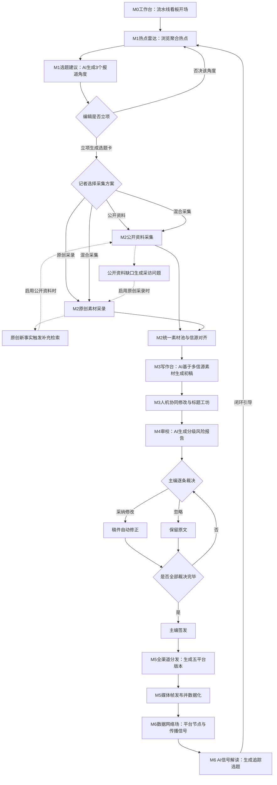
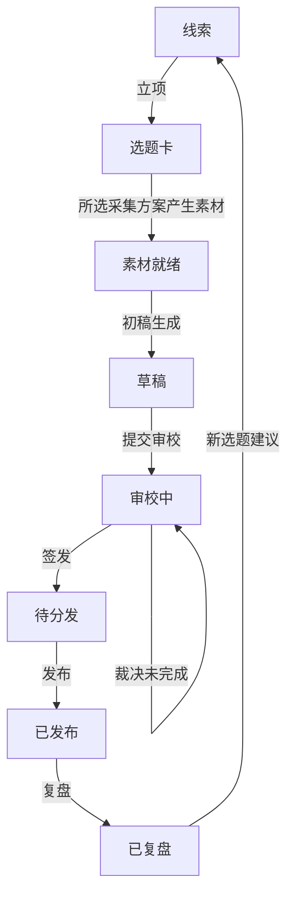

# PRD：「智媒编辑部」AI 新闻生产全流程演示原型（整体方案）

| 项目 | 内容 |
|------|------|
| 文档版本 | v1.6（效果洞察聚焦扩展传播网络与多类型图表） |
| 撰写日期 | 2026-07-18 |
| 需求分析依据 | `prd/需求分析/整体方案功能清单-AI智能编辑部.md` |
| 文档范围 | 整体方案 PRD。第五章为模块级详述；页面级详细 PRD 在整体方案确认后按模块另行撰写 |

---

## 一、需求背景

### 1.1 演示场合与受众

本原型用于第六届全国新闻传播学院院长研修班（中国新闻传播教育年鉴编撰委员会主办、深圳大学传播学院承办）现场演示。受众为全国新闻传播学院院长、副院长、教师、专家与管理者。

议程拆解结论：全部 11 场主题演讲中，5 场直接讨论"AI × 人才培养/教育变革"，4 场讨论学科建设与学院管理，2 场讨论国际传播人才培养；行业元素仅以实地教学（深圳特区报业集团、华为、腾讯）与参观国家级传媒实验教学示范中心的形式出现。受众核心关切为：AI 时代培养方案如何改、学生该训练什么能力、实验教学平台如何建设。

### 1.2 行业现状问题

新闻生产六环节（选题策划、资料与采访采集、写作、审核校对、多平台分发、效果复盘）中存在系统性效率痛点：线索监测靠人工刷平台；公开资料检索与原创采访彼此割裂；1 小时采访录音需约 4 小时人工整理；多信源事实难以对齐；初稿撰写、三审三校、多平台适配与传播复盘均存在大量重复劳动。

### 1.3 不做的影响

缺少可交互实物，演示停留在理念层面；无法向院长受众具象化"学生未来的工作现场"，错失建立实训平台共建合作意向的机会。

---

## 二、需求目标

| 编号 | 目标 | 衡量标准 |
|------|------|---------|
| G1 | 一条新闻的完整旅程串起采编发全流程 | 8-10 分钟走完六环节，叙事连续不中断 |
| G2 | 每环节呈现"痛点 → AI 介入 → 人做最终把关"三段式 | 每模块均含 AI 输出与人工采纳/否决交互 |
| G3 | 联结人才培养视角 | 教学视角开关开启后，每环节显示能力培养标注 |
| G4 | 演示绝对稳定 | 零依赖、离线运行、一键重置、可连续多场演示 |

**全局设计原则**：人主导 AI 辅助（所有 AI 输出须经人确认生效）；效果洞察反哺选题形成业务闭环；演示视觉冲击力优先于功能完备性。

---

## 三、需求核心业务流程图

### 3.1 演示主流程（含人工决策分支）

### 3.2 稿件状态机

稿件状态驱动 M0 流水线看板卡片流转，两图共用同一状态数据源。

### 3.3 核心对象闭环与状态约束

| 对象 | 创建 | 编辑/调整 | 移除/删除 | 状态约束 |
|------|------|----------|----------|----------|
| 选题卡 | M1人工确认立项 | 立项前可改角度；进入采集后修改选题会使素材及下游失效 | 主线Demo不做物理删除；全局重置清空 | 未立项不能进入正式采集 |
| 公开资料 | M2语义检索召回 | 不允许修改来源正文；可选择入池 | 移出素材池需确认；已生成稿件时移出会使初稿及下游失效 | 摘要不能脱离来源单独入池 |
| 原创素材 | M2录音、笔记、图片视频、文件创建 | 现场笔记可形成独立素材；ASR萃取项逐条选择 | 可移出素材池；已生成稿件时需二次确认 | AI萃取后由记者决定是否入池 |
| 稿件正文 | M3基于素材池生成 | 段落改写、采用、放弃、恢复原文 | 不做通用段落物理删除，避免破坏固定审校剧情 | 标题未选不能送审；送审后只读，退回后恢复编辑 |
| 审校裁决 | M4逐条采纳或忽略 | 未签发前可撤销 | 不做删除，以撤销表达 | 未全部裁决不能签发；签发后裁决、标题、正文只读 |
| 平台版本 | M5基于签发快照生成 | 发布前可查看、重生成和人工调整 | 发布前可移除并重生成；发布后不允许删除/覆盖 | 未就绪不能发布；发布后只读 |
| 追踪选题 | M6由洞察生成并送回M1 | M1可查看来源链并立项 | 可移出选题池/标记放弃，不物理删除来源记录 | 同一洞察只能加入一次 |

**失效规则**：

1. 素材变化 → 初稿、审校、签发快照、平台版本全部失效；
2. 正文或标题变化 → 审校、签发快照、平台版本失效；
3. 裁决变化 → 签发快照和平台版本失效；
4. 签发完成后不允许反向修改；正式产品应走撤回签发/新版本，演示原型不实现；
5. 发布完成后不允许修改或删除平台版本。

---

## 四、需求功能清单

终端统一为演示 Web 端（桌面浏览器，1920×1080 投屏优化），纯前端 Mock，无后端。

| 终端 | 模块 | 功能 | 描述 |
|------|------|------|------|
| 演示Web端 | M0 工作台 | -全局流程导航 | 顶部六环节步骤条，当前环节高亮，点击跳转对应模块 |
| 演示Web端 | M0 工作台 | -生产流水线看板 | 稿件卡片按状态机在六列间流转，状态变更有动效 |
| 演示Web端 | M0 工作台 | -编辑部数据概览 | 今日线索数、在产稿件数、已发布量等 Mock 大屏数字 |
| 演示Web端 | M1 智能选题 | -热点雷达 | 聚合热点列表，含热度值、趋势迷你图、来源分布标签 |
| 演示Web端 | M1 智能选题 | -AI选题建议卡 | 对选中热点打字机生成 3 个报道角度及三维评估 |
| 演示Web端 | M1 智能选题 | -选题立项弹窗 | 选定角度确认立项，生成选题卡并流转 M2 |
| 演示Web端 | M2 智能采集 | -采集方案选择 | AI建议并由记者选择公开资料、原创采录或混合采集 |
| 演示Web端 | M2 智能采集 | -公开资料语义检索 | 根据选题动态展示语义解析、概念扩展、跨源召回、去重和排序过程 |
| 演示Web端 | M2 智能采集 | -信息缺口联动 | 公开资料缺口生成采访问题；采访新事实触发补充检索 |
| 演示Web端 | M2 智能采集 | -原创素材采录 | 支持录音、现场笔记、图片视频与文件；ASR为可选能力 |
| 演示Web端 | M2 智能采集 | -统一素材池 | 汇总公开资料和原创采访素材，保留信源元数据 |
| 演示Web端 | M2 智能采集 | -信源对齐 | 标记相互印证、单一信源、无信源与冲突 |
| 演示Web端 | M3 智能写作台 | -AI初稿生成 | 基于选题卡与统一素材池，打字机分段生成结构化初稿 |
| 演示Web端 | M3 智能写作台 | -人机协同编辑 | 选中段落弹出改写/扩写/精简/换风格菜单，前后对比确认 |
| 演示Web端 | M3 智能写作台 | -标题工坊 | 生成严肃版/网感版/悬念版标题，单选采用 |
| 演示Web端 | M3 智能写作台 | -引用溯源标注 | 稿内事实点下划线标注，点击弹出素材来源卡片 |
| 演示Web端 | M4 智能审校 | -AI审校报告 | 事实核查/敏感表述/文字差错三类问题，高中低风险分级 |
| 演示Web端 | M4 智能审校 | -多模态影像甄别 | 检查生成式影像特征、EXIF信息和影像来源 |
| 演示Web端 | M4 智能审校 | -素材版权校验 | 视觉指纹比对、相似素材和授权状态检查 |
| 演示Web端 | M4 智能审校 | -逐条裁决操作 | 每条问题提供采纳修改/忽略按钮，稿件同步更新 |
| 演示Web端 | M4 智能审校 | -主编签发 | 裁决完毕后签发按钮激活，点击流转 M5 |
| 演示Web端 | M5 全渠道分发 | -一键多平台适配 | 并行打字机生成公众号推文/微博短讯/短视频口播脚本 |
| 演示Web端 | M5 全渠道分发 | -动态媒体帧 | 公众号、微博、短视频三个倾斜媒体帧并行生成 |
| 演示Web端 | M5 全渠道分发 | -英文国际版 | 生成英文版本（Could 级，可裁剪） |
| 演示Web端 | M5 全渠道分发 | -发布安全闸门 | 对合规、事实、影像真实性和版权授权进行发布前复检 |
| 演示Web端 | M6 效果洞察 | -数据网络场 | 稿源节点、五平台节点、传播路径与动态数据包 |
| 演示Web端 | M6 效果洞察 | -AI信号解读 | 生成传播分析、受众关切迁移与追踪选题 |
| 演示Web端 | M6 效果洞察 | -闭环引导入口 | "将建议加入热点雷达"按钮，跳回 M1 完成闭环 |
| 演示Web端 | G 全局 | -教学视角开关 | 全局浮动开关，开启后各模块显示能力培养标注浮层 |
| 演示Web端 | G 全局 | -演示一键重置 | 恢复全部初始状态，支持连续多场演示 |
| 演示Web端 | G 全局 | -打字机输出引擎 | 统一 AI 逐字输出组件，支持速度控制与跳过 |

---

## 五、需求功能详述

> 本章为模块级详述，粒度到模块的核心逻辑与验收口径；页面级字段、交互细节、Mock 文案在整体方案确认后的分模块 PRD 中展开。

---

#### 5.1 演示Web端——M0 工作台——全局导航与流水线看板

**原型描述**：
深色大屏风格首页。顶部横向六环节步骤条（选题→采访→写作→审校→分发→洞察）；中部六列流水线看板，演示稿件以卡片呈现；顶部右侧三枚 Mock 统计数字翻牌动效。

**用户故事**：
> 作为演示者，我想要一个总览开场页，以便于先给听众建立"新闻生产流水线"的整体认知，再进入单环节演示。

**前置条件**：
- 无（演示入口页）

**核心逻辑**：
- 看板卡片位置由稿件状态机驱动，状态存于全局 JS 状态对象；
- 步骤条与各模块页面路由一一对应（单页应用内视图切换，无真实路由）；
- 演示稿件初始位于"选题"列。

**边界条件与异常处理**：
- 直接点击后续环节步骤条时允许跳转（演示者可能需要跳跃演示），页面按该环节的预设完成态渲染；
- 重置后卡片回到初始列。

**技术难点分析**：
- 状态机与六个模块视图的联动一致性（单一全局状态对象解决）。

**验收标准 (Acceptance Criteria)**：
- 🎯 **成功场景**：完成 M1 立项后返回 M0，卡片已从"选题"列移至"采访"列且有流转动效
- ✔️ **校验场景**：跳跃点击"分发"步骤条，M5 按预设完成态渲染，无空白页
- ❌ **异常场景**：连续快速切换视图不出现残留 DOM 或动画错乱

**测试用例**：
- 初始进入看板卡片位于选题列
- 每完成一环节卡片流转一列
- 跳跃导航渲染预设完成态
- 重置后看板恢复初始

---

#### 5.2 演示Web端——M1 智能选题——热点雷达与选题建议

**原型描述**：
左侧热点列表（热度值、趋势迷你折线、来源标签），"低空经济"条目热度最高置顶并带脉冲标记；右侧空态提示"点选热点，AI 生成报道角度"。点击后右侧打字机生成 3 张角度卡，各含新闻价值/时效性/操作难度三维评分条。

**用户故事**：
> 作为编辑，我想要 AI 聚合热点并给出报道角度评估，以便于把每天数小时的刷平台时间压缩为分钟级决策。

**前置条件**：
- 演示处于初始态或从 M6 闭环跳回

**核心逻辑**：
- 热点列表为预置数组渲染；点击热点触发对应预置角度卡脚本；
- 演示主线剧本：选择"低空经济"→ 选定"民生视角"角度 → 立项弹窗确认 → 生成选题卡，稿件状态置为"选题卡"，自动跳转 M2；
- 从 M6 闭环返回时，热点列表顶部插入一条新线索"低空物流安全监管"并高亮，完成闭环可视化。

**边界条件与异常处理**：
- 点选非主线热点：亦有预置角度卡（每个热点至少 1 套），但立项按钮仅主线角度可用，其余提示"演示主线请选择低空经济"；
- 重复点击同一热点不重复触发打字机，直接显示已生成结果。

**技术难点分析**：
- 趋势迷你图零依赖绘制（内联 SVG polyline 解决）。

**验收标准 (Acceptance Criteria)**：
- 🎯 **成功场景**：点击"低空经济"，3 张角度卡打字机生成完毕，选定后立项成功跳转 M2
- ✔️ **校验场景**：未选定角度直接点立项，按钮禁用态不响应
- ❌ **异常场景**：打字机输出中途点击其他热点，当前输出立即终止并切换，无文本串扰

**测试用例**：
- 点击热点生成 3 张角度卡
- 非主线角度立项被拦截提示
- 立项后跳转 M2 且状态更新
- 闭环返回时新线索置顶高亮

---

#### 5.3 演示Web端——M2 智能采集——公开资料与原创采访双轨采集

**原型描述**：
顶部显示 AI 建议采集方案。混合模式采用纵向单页：公开资料语义检索在上，原创采录在下，统一素材池与信源对齐位于页面底部。语义检索展示6阶段过程和10条多类型结果；原创采录支持录音ASR、现场笔记、图片视频和文件。单轨模式隐藏未启用区，其他区域全宽显示。

**用户故事**：
> 作为记者，我想要根据选题自由选择采集方式，并在需要时组合公开资料与原创素材，以便于不被迫经过采访或 ASR。

**前置条件**：
- 稿件状态为"选题卡"

**核心逻辑**：
- 三种采集方案均为正常流程，不把单轨视为降级；
- 只有混合模式同时显示两条轨道，且不设置先后或解锁关系；
- 原创采录不要求使用 ASR，一条现场笔记也可形成原创素材；
- 公开资料缺口可生成采访问题，采访出现新事实可生成补充检索任务；
- 两类素材均由记者勾选后进入统一素材池并保留信源元数据；
- AI 按事实主题实时计算信源对齐状态；
- 主线全选后素材池为10张公开资料卡 + 13条采访素材；
- 统一素材池非空即可进入 M3；public/original 模式直接完成，只有 hybrid 模式缺少一轨时需要确认；风险项不拦截但传递至 M4。

**边界条件与异常处理**：
- 语义检索结果均为预置 Mock，但查询词、检索阶段、结果排序和选择过程动态呈现，不发起网络请求；
- 采访支持倍速和跳到结尾；
- 混合模式下一条轨道生成或播放时，另一条轨道保持可操作；
- 未启用原创采录时不渲染播放条和 ASR；
- 未归档任何素材时"完成采集"禁用。

**技术难点分析**：
- 转写时间轴与萃取浮现同步调度；
- 统一素材池为唯一数据源，信源对齐结果由素材池派生，M3/M4 不重复计算。

**验收标准 (Acceptance Criteria)**：
- 🎯 **成功场景**：采访00:12入池后显示“1.2万单直接信源”，选择P9后补充行业规模参照并明确口径不同
- ✔️ **校验场景**：公开资料模式选中1项即可进入 M3，不显示采访缺失警告
- ✔️ **校验场景**：混合模式仅完成一轨时弹出方案未完整确认
- ❌ **异常场景**：连续播放/暂停不重复渲染；公开资料选择状态不受影响

**测试用例**：
- 两轨并行可操作
- 10条语义检索结果字段完整
- 13条采访素材萃取完整
- 信源对齐随选择更新
- public/original 模式完成条件正确
- hybrid 缺轨确认两分支正确
- 零素材完成按钮禁用

---

#### 5.4 演示Web端——M3 智能写作台——初稿、协同编辑与标题

**原型描述**：
三栏布局：左栏选题卡与统一素材池（公开资料/原创采访分类，可折叠）；中栏富文本稿件区；右栏 AI 助手面板。点击"生成初稿"中栏打字机分段成文；选中段落浮现操作菜单；顶部标题区点击"标题工坊"弹出三风格标题单选。

**用户故事**：
> 作为记者，我想要 AI 基于公开资料与原创采访组成的统一素材池生成初稿并辅助润色，以便于提高效率并保持事实可溯源。

**前置条件**：
- 稿件状态为"素材就绪"

**核心逻辑**：
- 初稿为预置文本，分段打字机渲染；稿中事实点带溯源下划线，点击弹出对应素材卡片；
- 初稿中预埋差错："无人机日均配送 12 万单"（与 P2 公开资料和采访 00:12 的"1.2 万单"均不符，供 M4 演示三栏事实核查）；
- 段落操作菜单触发预置改写文本，以前后对比卡呈现，人工点击"采用"才替换正文；
- 采用标题后"提交审校"激活，状态置"草稿→审校中"并跳转 M4。

**边界条件与异常处理**：
- 每个段落至少预置 1 种操作的改写结果，未预置的操作按钮隐藏（不出现点了没反应）；
- 对比卡未确认前正文不变，点"放弃"关闭对比卡。

**技术难点分析**：
- 富文本区内溯源标注与段落选中交互并存（contenteditable 不启用，用只读 DOM + 段落级选中简化）。

**验收标准 (Acceptance Criteria)**：
- 🎯 **成功场景**：生成初稿含"12 万单"文本；选中导语点"精简"，对比卡出现，采用后正文替换
- ✔️ **校验场景**：未选标题时提交审校按钮禁用
- ❌ **异常场景**：打字机生成中操作菜单不可用，避免状态竞争

**测试用例**：
- 初稿分段打字机生成完整
- 溯源点点击弹出素材卡
- 改写需人工采用才生效
- 未选标题提交被拦截

---

#### 5.5 演示Web端——M4 智能审校——分级报告与人工裁决

**原型描述**：
左侧稿件全文，问题处按风险色高亮（高红/中橙/低黄）；右侧审校报告列表，每条含问题类型、原文摘录、AI 修改建议、依据说明、采纳/忽略按钮；顶部三色风险计数徽章；底部签发按钮（初始禁用）。

**用户故事**：
> 作为主编，我想要 AI 先完成事实核查与差错扫描、我做最终裁决，以便于三审三校提速且把关权始终在人。

**前置条件**：
- 稿件状态为"审校中"

**核心逻辑**：
- 预置问题清单（本模块为全场高光，问题设计固定）：
  - 高风险·事实核查："日均配送12万单"与采访00:12的"日均1.2万单"矛盾；21财经年度订单数据作为不同口径的规模参照；
  - 中风险·表述规范："全国第一"改为"全国领先"，P1-P10 与采访均无排名依据；
  - 低风险·文字差错：错别字与标点各 1 处；
- 点击报告条目，左侧对应高亮滚动定位；采纳后稿件文本即时修正、条目置绿勾；忽略置灰；
- 全部条目裁决完毕签发按钮激活；点击签发播放签章动效，状态置"待分发"并跳转 M5。

**边界条件与异常处理**：
- 已裁决条目可撤销重新裁决（演示者误点可挽回）；
- 高风险条目选择忽略时出现二次确认（强化"人负最终责任"的叙事）。

**技术难点分析**：
- 稿件高亮区与报告列表的双向联动定位。

**验收标准 (Acceptance Criteria)**：
- 🎯 **成功场景**：采纳事实核查条目后，正文"12 万单"变为"1.2 万单"并闪烁确认
- ✔️ **校验场景**：存在未裁决条目时签发按钮禁用
- ❌ **异常场景**：忽略高风险条目弹出二次确认，取消后状态不变

**测试用例**：
- 报告条目与原文高亮双向定位
- 采纳后正文即时修正
- 全部裁决后签发才激活
- 忽略高风险有二次确认

---

#### 5.6 演示Web端——M5 全渠道分发——五平台适配工作区

**原型描述**：
发布黄主场下的功能化分发工作区：签发状态条（签发章、稿件标题、事实口径、就绪计数）+ 流程轨 + 三栏工作区（平台版本列表 / 仿真预览 / 发布检查）。点击一键适配后公众号、微博、抖音、小红书、头条号五个平台版本错峰生成；可选英文版为第六版本；发布前需通过四项安全复检，发布时收缩为数据包并进入 M6 传播节点。

**用户故事**：
> 作为编辑，我想要一次签发自动适配全部平台版本，以便于消灭一稿多改的重复劳动。

**前置条件**：
- 稿件状态为"待分发"

**核心逻辑**：
- 五平台版本为预置文案：公众号版含小标题、数据摘要条与配图占位，微博版 140 字内带话题标签与投票组件，抖音版为逐镜口播分镜表，小红书版为"亲测"视角笔记（三宫格 + 场景要点清单），头条号版为要点速览 + 通讯社体资讯；
- 五版本错峰依次生成（间隔约 0.4s），视觉上呈现"流水线适配"；
- 发布前需通过四项安全复检；点击发布后收缩为数据包并沿路径进入 M6，状态置"已发布"。

**边界条件与异常处理**：
- 生成完毕前发布按钮禁用；
- 英文版为 Could 级，默认折叠入口，点击才生成。

**技术难点分析**：
- 三路打字机并行的性能与节奏控制（单一 requestAnimationFrame 调度器分发）。

**验收标准 (Acceptance Criteria)**：
- 🎯 **成功场景**：一键适配后五版本依次生成，风格差异肉眼可辨
- ✔️ **校验场景**：生成中发布按钮禁用
- ❌ **异常场景**：生成中切走再切回，内容完整不丢失

**测试用例**：
- 五平台版本生成完整
- 五平台预览形态正确（含投票组件、分镜表、三宫格、要点速览框）
- 发布后状态流转 M6
- 英文版按需展开生成

---

#### 5.7 演示Web端——M6 效果洞察——数据网络场与闭环

**原型描述**：
冷白点阵背景中，签发稿源节点通过三条传播路径连接公众号、微博、短视频节点；数据包落入节点后显示指标。右侧 AI 信号解读生成传播结论、受众关切迁移与追踪选题；黄色新选题数据包反向回到 M1。

**用户故事**：
> 作为编辑部负责人，我想要发布后自动汇总各平台数据并生成复盘与新选题建议，以便于数据反哺下一轮选题决策。

**前置条件**：
- 稿件状态为"已发布"

**核心逻辑**：
- 内联 SVG 绘制三条贝塞尔传播路径，数据包与节点一一对应；
- AI 信号解读含追踪选题"低空物流安全监管"；
- 点击闭环按钮后黄色新选题数据包反向移动，跳转 M1 并落为 H7 头条卡。

**边界条件与异常处理**：
- 图表动画只播一次，重复进入直接显示终态；
- 闭环按钮点击后置灰防重复插入。

**技术难点分析**：
- 响应式节点 DOM 坐标与 SVG 贝塞尔路径端点同步，不引入图表库。

**验收标准 (Acceptance Criteria)**：
- 🎯 **成功场景**：数据包落入三平台节点，AI 信号解读生成追踪建议
- ✔️ **校验场景**：重复进入不重播动画
- ❌ **异常场景**：闭环按钮重复点击不重复插入线索

**测试用例**：
- 网络路径与数据包动画一次性播放
- AI 信号解读含追踪选题建议
- 闭环跳转后新线索置顶
- 状态最终为已复盘

---

#### 5.8 演示Web端——G 全局——教学视角开关、重置与打字机引擎

**原型描述**：
右下角悬浮胶囊控件含两钮：教学视角开关（学位帽图标）、演示重置（刷新图标）。教学视角开启后各模块右上滑出米色便签风格浮层，列出该环节对应的培养能力与课程建议。

**用户故事**：
> 作为面向院长演示的讲解者，我想要一键切换"行业视角/教学视角"，以便于同一个 Demo 既证明行业理解、又落点人才培养。

**前置条件**：
- 无（全局可用）

**核心逻辑**：
- 教学视角为全局布尔态，各模块浮层文案预置（示例——M1：数据素养与新闻敏感训练；M3：人机协同写作能力；M4：AI 时代把关人素养与媒介伦理；文案待确认后在模块 PRD 固化）；
- 重置：还原全局状态对象并回到 M0，含二次确认弹窗；
- 打字机引擎：统一组件，参数含速度/分段延迟/完成回调，全局提供"跳过动画"快捷键（空格双击），供演示时间告急时使用。

**边界条件与异常处理**：
- 重置二次确认防误触；
- 教学浮层不遮挡模块核心操作区（定位于右上角，可手动关闭）。

**技术难点分析**：
- 打字机引擎的中断/跳过/回调时序正确性（所有模块复用，需一次做对）。

**验收标准 (Acceptance Criteria)**：
- 🎯 **成功场景**：任一模块开启教学视角，浮层显示对应能力标注；关闭即隐藏
- ✔️ **校验场景**：重置弹出二次确认，取消则状态不变
- ❌ **异常场景**：打字机输出中触发跳过，文本立即完整呈现且完成回调正常触发

**测试用例**：
- 教学开关全局同步生效
- 重置后全部状态还原
- 跳过动画文本完整回调正常
- 教学浮层可手动关闭

---

## 附：分模块 PRD 撰写计划（整体方案确认后执行）

| 序号 | 文档 | 覆盖内容 |
|------|------|---------|
| 1 | `prd/模块PRD/M0-工作台.md` | 页面级字段、看板动效规格、Mock 统计数据字典 |
| 2 | `prd/模块PRD/M1-智能选题.md` | 热点数据字典（含全部非主线热点文案）、角度卡全文案 |
| 3 | `prd/模块PRD/M2-智能采集.md` | 公开资料卡、跨轨联动、逐字稿、萃取映射与信源对齐 |
| 4 | `prd/模块PRD/M3-智能写作台.md` | 初稿全文、各段落改写文本、标题三版本、溯源映射 |
| 5 | `prd/模块PRD/M4-智能审校.md` | 问题清单全文案、依据面板内容、裁决状态机 |
| 6 | `prd/模块PRD/M5-全渠道分发.md` | 五平台版本全文案、仿真 UI 规格、英文版文案 |
| 7 | `prd/模块PRD/M6-效果洞察.md` | 图表数据字典、复盘报告全文案 |
| 8 | `prd/模块PRD/G-全局组件.md` | 教学浮层全文案、打字机引擎 API、视觉规范（色板/字体/间距） |

前置待确认项（见需求分析文档第五章）：主线选题题材、产品命名、教学标注文案口径、英文版是否纳入首版。
