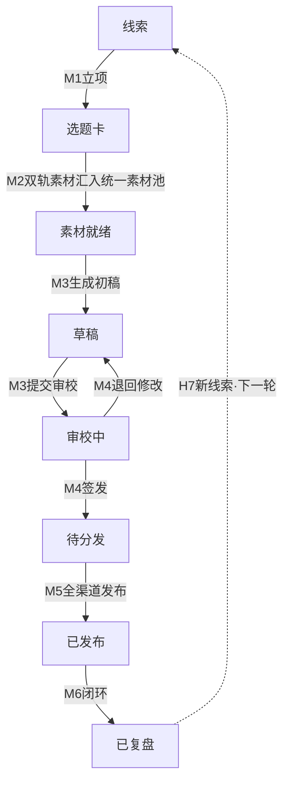
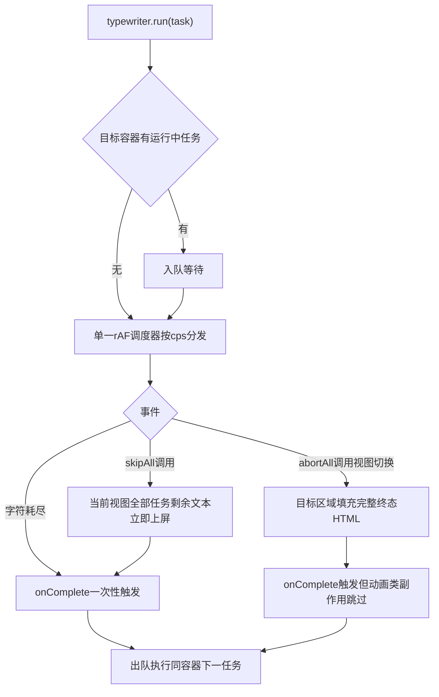

# 模块 PRD：G 全局组件与视觉规范

| 项目 | 内容 |
|------|------|
| 文档版本 | v2.3（M2 按需采集模式状态；保留最终视觉规范） |
| 上游文档 | `prd/PRD-智媒编辑部-整体方案.md` §5.8 |
| 数据来源 | `00-叙事主线与全局数据字典.md` D7（教学浮层）、D0（角色） |
| 覆盖内容 | 全局状态机、打字机引擎、教学视角、重置、Toast/弹窗、角色徽章、视觉规范 |

---

## 一、模块定位与功能分析

七个视图共享一套基础设施，其质量决定演示稳定性的下限：

1. **全局状态机**：单一数据源，让"跳跃演示""看板联动""退回回流""一键重置"四类跨模块行为完全可预测；
2. **打字机引擎**：所有"AI 生成感"的唯一来源，被 6 个模块约 15 处调用，中断/跳过/回调时序必须一次做对；
3. **教学视角**：本 Demo 区别于普通行业演示的定位点睛——行业叙事与教育叙事的一键切换；
4. **演示保障组件**：重置（连场演示）、Toast（动线拦截）、角色徽章（把关链可视化）。

## 二、全局状态机（信息架构核心）

### 2.1 状态对象全量定义

```
state = {
  // 流程主干
  currentStep: 'dashboard',   // dashboard|topics|collection|writing|review|channels|insights
  storyStatus: '线索',         // 见 2.2 状态机
  // M1
  selectedHotspot: null, generatedAngles: {}, loopInserted: false,
  // M2
  collectionMode: null,       // public|original|hybrid
  enabledTracks: [],          // public|original
  publicSourcesLoaded: false,
  selectedPublicSources: [],
  originalMaterials: [],      // 现场笔记/图片视频/文件等非ASR原创素材
  interviewDone: false,
  selectedInterviewMaterials: [],
  materials: [],              // 两类素材的统一只读派生集合
  sourceAlignment: {},        // corroborated|single_source|unsupported|conflict
  // M3
  draftGenerated: false, titlesGenerated: false, selectedTitle: null,
  paragraphEdits: {}, m3Readonly: false, returnNote: null,
  // M4
  reviewScanned: false, reviewDecisions: {}, m4Readonly: false,
  // M5
  channelsGenerated: false, enExpanded: false, m5Published: false,
  // M6
  insightsAnimPlayed: false, loopBack: false,
  // M0 / 全局
  dashboardAnimPlayed: false, teachingMode: false
}
```

### 2.2 稿件状态机（含退回回路）



### 2.3 fastForward 预设表（跳跃演示的完整定义）

点击未到达的步骤条节点时，一次性推进 state 至该环节的"前置完成态"（只进不退，已推进字段不覆盖）：

| 跳往 | storyStatus | 追加预设 |
|------|-------------|---------|
| topics | 线索（不推进） | 无 |
| collection | 选题卡 | `collectionMode='hybrid'`、`enabledTracks=['public','original']`（主线预设；用户正常进入时可改选任一模式） |
| writing | 素材就绪 | 主线 fastForward 使用 `hybrid`：P1-P10 + 采访素材13项 = 23项；正式逻辑同时支持 public/original 模式的非空素材池 |
| review | 审校中 | 上行 + `draftGenerated=true`、`selectedTitle=TITLES 网感版`、`m3Readonly=true` |
| channels | 待分发 | 上行 + `reviewDecisions` 四条全 accepted、`reviewScanned=true`、`m4Readonly=true` |
| insights | 已发布 | 上行 + `channelsGenerated=true`、`m5Published=true` |

### 2.4 观察者机制

`setState(patch)` 合并后依次通知订阅者（步骤条、M0 看板、角色徽章、教学浮层）。订阅者只读 state 重渲染，不得在回调内再 setState（防环）。

## 三、核心流程图（打字机引擎生命周期）



## 四、功能清单

| 终端 | 模块 | 功能 | 描述 | 优先级 |
|------|------|------|------|--------|
| 演示Web端 | G | -全局状态机 | state/setState/fastForward/观察者 | Must |
| 演示Web端 | G | -打字机引擎 | run/skipAll/abortAll，HTML 感知，队列与并行 | Must |
| 演示Web端 | G | -教学视角开关 | 悬浮胶囊 + 各模块便签浮层（D7） | Should |
| 演示Web端 | G | -演示一键重置 | 二次确认 + location.reload | Must |
| 演示Web端 | G | -Toast与弹窗 | 全局轻提示与模态组件 | Must |
| 演示Web端 | G | -角色徽章 | 导航栏右端当前角色显示（D0 映射） | Should |
| 演示Web端 | G | -页脚虚构声明 | 全视图常驻 | Must |

## 五、需求功能详述

#### 5.1 全局状态机

**原型描述**：无界面。API：`setState(patch)`、`onStateChange(fn)`、`fastForward(step)`。

**用户故事**：
> 作为实现者，我想要单一状态源与统一推进函数，以便于跳跃、回流、重置、联动四类跨模块行为可预测、可测试。

**前置条件**：无。

**核心逻辑**：见 §二。补充规则：
- `fastForward` 内部按 §2.3 表逐字段"缺则补"（已有值不覆盖，保证只进不退）；
- M4 退回是唯一合法回退，由显式 `retreatToDraft()` 函数处理（storyStatus 审校中→草稿 + 清 M4 字段），不走 fastForward。

**边界条件与异常处理**：
- 任何模块读取不存在字段 → 开发期 console.warn（发布前清零）；
- 观察者回调抛错不中断其余订阅者（try/catch 隔离）。

**验收标准 (Acceptance Criteria)**：
- 🎯 **成功场景**：初始态直接点"分发"，M5 完整可演示
- ✔️ **校验场景**：走完 M2 后跳"审校"，materials 不被预设覆盖
- ❌ **异常场景**：退回后 fastForward 不复活已清空的裁决

**测试用例**：
- 六目标预设表逐项生效
- 只进不退规则
- 退回函数字段清理完整
- 观察者异常隔离

#### 5.2 打字机引擎

**原型描述**：输出 = 逐字上屏 + 尾部品牌色竖线光标闪烁（完成后光标消失）。

**用户故事**：
> 作为演示者，我想要所有 AI 输出有生成临场感且随时可跳过，以便于真实感与时间控制兼得。

**前置条件**：无。

**核心逻辑**：
- API：`typewriter.run({ el, html, cps=40, onComplete }) → handle`；
- HTML 感知：预解析为指令序列（TEXT 逐字 / ELEMENT 整体插入），溯源 span、话题标签等内联元素不破碎；
- 队列：同容器串行、异容器并行（M5 三媒体帧）；全局单 rAF 调度器；
- `skipAll()`：空格双击（300ms 窗口）触发，当前视图所有任务立即完成；
- `abortAll()`：router 视图切换时调用，容器填终态 HTML，onComplete 的状态推进执行、动画副作用跳过（副作用注册时声明类型 `{stateFx, animFx}`）；
- onComplete 幂等（内部 fired 标记）。

**边界条件与异常处理**：
- 同容器重复 run 旧任务未完 → 旧任务 abort 后新任务执行（M1 切换热点场景）；
- cps 默认 40，长文本（M3 六段）可分段任务链避免单任务超长。

**技术难点分析**：
- 指令序列解析：用 `template` 元素解析 HTML → 深度优先遍历生成指令 → 消费时按父子关系重建 DOM。

**验收标准 (Acceptance Criteria)**：
- 🎯 **成功场景**：M3 生成中空格双击，六段立即完整、字数统计出现
- ✔️ **校验场景**：M5 五平台版本生成中，skip 令全部版本同时完成
- ❌ **异常场景**：生成中切视图再返回，终态完整、状态副作用不重复

**测试用例**：
- 内联标记不破碎
- onComplete 单次触发
- 同容器队列串行
- 异容器并行
- abort 终态与副作用分类执行

#### 5.3 教学视角开关

**原型描述**：
右下悬浮胶囊两钮：🎓学位帽（教学视角）+ ↻刷新（重置）。开启教学视角：按钮品牌色填充，当前视图右上滑出 280px 米色便签浮层（`#FFF8E7` 底 + 虚线边框 + 轻微旋转 -1°，"批注感"）：标题"教学视角 · {模块名}" + 三行（🎯培养能力 / 📚课程结合 / 👁考核观察点，文案取 D7 对应行）+ 右上关闭叉。切换视图浮层内容随之更新（重新滑入）。

**用户故事**：
> 作为讲解者，我想要一键在"行业工作台"上叠加"教学批注层"，以便于同一 Demo 完成行业理解与人才培养的双重叙事——这是面向院长听众的定位点睛。

**前置条件**：无。

**交互逻辑明细**：

| 触发 | 行为 | 状态变更 |
|------|------|---------|
| 点击学位帽（关→开） | 按钮填充 + 当前视图浮层滑入 | `teachingMode=true` |
| 点击学位帽（开→关） | 浮层滑出 + 按钮还原 | `teachingMode=false` |
| 开启态切换视图 | 新视图浮层滑入（内容按 D7 映射） | 无 |
| 点击浮层关闭叉 | 本视图本次隐藏；切换视图或重开开关后再现 | 无 |

**边界条件与异常处理**：
- 浮层 z-index 低于模态弹窗，高于普通内容；定位右上不遮挡任何模块主按钮（主按钮均在中/右下，逐视图核对）；
- 演示建议（讲稿）：主线走完后开启，从 M6 倒序回看 M4/M3/M2 做教学叙事二次收口。

**验收标准 (Acceptance Criteria)**：
- 🎯 **成功场景**：M4 开启显示"AI 时代把关人素养与媒介伦理"
- ✔️ **校验场景**：关闭开关全视图无浮层
- ❌ **异常场景**：浮层不遮挡各视图主按钮（七视图逐一核对）

**测试用例**：
- 七视图文案与 D7 一致
- 开关全局同步
- 手动关闭后切视图再现
- 与弹窗层级正确

#### 5.4 演示一键重置

**原型描述**：胶囊刷新钮 → 模态确认："重置演示？将清空全部进度回到初始状态。【取消】【重置】" → 确认后 0.3s 淡出 → `location.reload()`。

**用户故事**：
> 作为演示者，我想要一键回到出厂状态，以便于连场演示和现场失误重来。

**前置条件**：无。

**核心逻辑**：无持久化存储，reload 即出厂（实现最简且绝对干净）；确认框防误触（遮罩点击 = 取消）。

**验收标准 (Acceptance Criteria)**：
- 🎯 **成功场景**：任意进度重置后回 M0 初始态、翻牌动画重播
- ✔️ **校验场景**：取消后进度保持
- ❌ **异常场景**：闭环后重置，H7 消失、全部只读态解除

**测试用例**：
- 任意状态重置干净
- 确认取消两分支
- 重置后可完整重走主线

#### 5.5 Toast、模态弹窗与角色徽章

**原型描述**：
- Toast：顶部中央滑入深色胶囊，2.5s 自动消失，同屏 1 条后来顶替；
- 模态：居中卡片 + 60% 遮罩，API `modal({title, body, actions}) → Promise`，Esc/遮罩 = 取消（危险操作弹窗如 R1 忽略除外——仅显式按钮可关）；
- 角色徽章：导航栏右端头像 + 姓名 + 职务小字，按视图映射（D0：M1/M5/M6→林之桐、M2/M3→张倩、M4→王一舟、M0→"编辑部全景"无徽章），切换时翻转动画——把关链角色交接的可视化。

**用户故事**：
> 作为演示者，我想要拦截提示轻量、确认弹窗统一、当前角色明示，以便于演示流畅且"多角色把关链"随时可指认。

**前置条件**：无。

**边界条件与异常处理**：
- Toast 与弹窗共存时 toast 在弹窗之上不遮挡按钮；
- 角色徽章在 fastForward 跳跃时同步更新。

**验收标准 (Acceptance Criteria)**：
- 🎯 **成功场景**：进入 M4 徽章翻转为王一舟
- ✔️ **校验场景**：连续两条 toast 仅显示最新
- ❌ **异常场景**：R1 忽略弹窗点遮罩不关闭

**测试用例**：
- 徽章视图映射正确
- Toast 顶替机制
- 危险弹窗仅按钮可关

## 六、视觉规范

| 项 | 规范 |
|----|------|
| 总体叙事 | A1-A4 为“铅字新闻”：新闻在纸上生产；A5 为“发布黄分发工作区”：稿件进入五平台多屏传播（视觉体系融入功能组件，不设纯装饰元素）；A6 为“数据网络场”：平台版本转化为传播节点。完整规范见 `docs/superpowers/specs/2026-07-18-智媒编辑部视觉设计.md` |
| A1-A4 基底 | 暖白纸底 `#F7F5F0`、内容白 `#FDFCF9`、油墨黑 `#1A1817`、次级灰褐 `#5C5852`、1px 栏线 `#D8D2C4` |
| A1-A4 关键色 | 报头红 `#C8102E` 仅用于立项、风险、签发等人工责任动作；AI 批注黄 `#FFE96B` |
| A5 基底 | 发布黄 `#FFED00`；3px 油墨黑硬描边；媒体帧硬阴影；反馈洋红 `#FF3AA7`；内容信号青 `#00D7FF` |
| A6 基底 | 冷白点阵 `#F7FAF9`；冷灰描边 `#AAB9C0`；内容信号青 `#00A9BD`；受众反馈洋红 `#FF3AA7`；新选题黄 `#FFED00` |
| 字体 | 新闻标题、稿件与洞察结论：`Georgia, "Noto Serif SC", "Songti SC", SimSun, serif`；平台状态、数据节点：`"Courier New", monospace`；正文与操作：系统无衬线 |
| 字号 | A5 动态主标题 96-150 / A6 结论标题 60-80 / 数据 29-46 / 页面标题 22 / 卡片标题 16 / 正文 14 / 辅助 10-12；稿件正文 16/行高 1.8 |
| 圆角 | A1-A4：0-4px；A5 媒体帧：0px；A6 节点：0-4px；仅全局胶囊按钮使用 999px |
| 动效 | 微交互 200ms / 看板流转 400ms / 签发切帧 1.2s / 三媒体帧错峰 0、0.5、1s / 媒体帧数据化转场 1.5s / 数据路径绘制 1.2s；全部支持跳过 |
| 教学浮层 | 米色便签 `#FFF8E7` + 深棕 `#5C4A1F` + 虚线框 + 旋转 -1°；在 A5/A6 中仍保持纸质批注外观，作为教育视角跨媒介的继承元素 |
| 分辨率 | 1920×1080 优化，≥1440 可用，不做移动端 |
| 打字机光标 | A1-A4 使用报头红；A5 使用洋红；A6 使用信号青；2px 竖线，530ms 闪烁，完成即隐 |

### 6.1 跨模块转场

| 转场 | 视觉动作 | 业务状态 |
|------|---------|---------|
| A4 → A5 | 红色签发章定格 300ms；稿件版面横向切分为媒体帧；背景切换为发布黄；进入五平台分发工作区 | `审校中 → 待分发` |
| A5 → A6 | 五平台版本发布后收缩为数据包；数据包沿五色连接线分别落入 A6 五个平台节点（搜索/英文为次级节点）；背景变为冷白点阵 | `待分发 → 已发布` |
| A6 → A1 | 黄色新选题数据包沿反向路径飞出；跳转 M1 后落为 H7 头条卡 | `已发布 → 已复盘` |

转场仅表达既有状态变化，不增加状态机节点。调用 `typewriter.skipAll()` 或切换视图时，当前转场直接进入目标模块稳定终态。

## 七、状态与数据依赖

| 方向 | 内容 |
|------|------|
| 读取 | `TEACHING_NOTES`（D7）、D0 角色映射、全量 state |
| 写入 | `teachingMode`；`setState/fastForward` 为全部模块的写入通道 |
| 上游依赖 | 无（基础设施层） |
| 下游供给 | 全部模块 |
