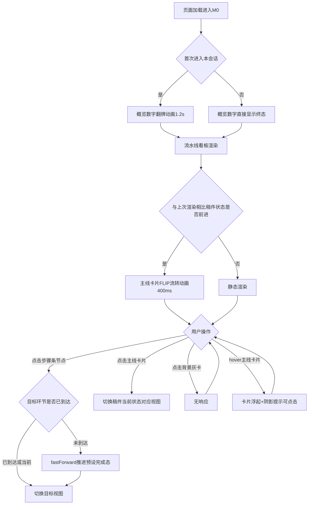

# 模块 PRD：M0 工作台

| 项目 | 内容 |
|------|------|
| 文档版本 | v2.1（M2 从采访升级为智能采集） |
| 上游文档 | `prd/PRD-智媒编辑部-整体方案.md` §5.1 |
| 数据来源 | `00-叙事主线与全局数据字典.md` D6-E（概览数字）、D6-F（背景卡）、D0（角色） |
| 视图 ID | `view-dashboard` |
| 当前角色 | 无特定角色（编辑部全景视角） |

---

## 一、模块定位与功能分析

M0 承担三个不可替代的职责：

1. **开场认知锚点**：演示第一屏。听众在进入任何单环节之前，必须先建立"新闻生产是一条六环节流水线"的心智模型，后续所有模块讲解都挂靠在这条流水线上；
2. **状态可视化枢纽**：演示过程中稿件状态的唯一全景视图。演示者任何时刻回到 M0，都能向听众指出"我们的稿件现在走到了这里"；
3. **规模感营造**：通过概览数字和背景稿件卡，暗示这是一个"正在运转的编辑部"而非单稿演示玩具——多条稿件并行流动的画面本身就是产品成熟度的视觉证言。

**本模块刻意不做**：稿件列表管理、筛选搜索、多稿件详情——演示只有一条主线稿件可交互，管理功能属于正式产品范畴（v1.0 方法论：演示原型可抛弃、验证概念优先）。

## 二、用户与场景

**场景 A：开场（演示动线第 1 步，约 40 秒）**
演示者打开 `index.html`，投屏呈现 M0。概览数字翻牌动画抓住注意力 → 演示者用步骤条讲一遍六环节 → 指着看板说"今天我们跟着这张卡片走完全程" → 点击主线卡片或步骤条"选题"进入 M1。

**场景 B：环节间回访（可选，每次约 10 秒）**
每完成一个环节，演示者可返回 M0 展示卡片流转动画，强化"流程推进"的感知。时间紧张时跳过，直接模块间跳转。

**场景 C：听众提问跳转**
问答环节听众问某个环节，演示者回 M0 点击对应步骤条节点直达。

**进入方式**：页面加载默认视图；顶部导航"工作台"入口；步骤条左侧 Logo 点击。
**离开方式**：点击步骤条节点 / 点击主线卡片。

## 三、业务流程图



## 四、信息架构与关键界面

### 4.1 页面布局（1920×1080）

```
┌────────────────────────────────────────────────────────────────┐
│ 全局导航栏（64px 高，所有视图共享）                                │
│ [Logo 智媒编辑部]  [选题]─[采集]─[写作]─[审校]─[分发]─[洞察]  [工作台]│
├────────────────────────────────────────────────────────────────┤
│ 概览数字区（120px 高）                                            │
│ [今日新增线索 328] [在产稿件 12] [本周已发布 47] [平均提效 63%]     │
├────────────────────────────────────────────────────────────────┤
│ 生产流水线看板（剩余高度，六等分列）                                │
│ ┌选题(3)┐ ┌采集(2)┐ ┌写作(3)┐ ┌审校(2)┐ ┌分发(2)┐ ┌洞察(3)┐      │
│ │★主线卡│ │ 灰卡  │ │ 灰卡  │ │ 灰卡  │ │ 灰卡  │ │ 灰卡  │      │
│ │ 灰卡  │ │      │ │ 灰卡  │ │      │ │      │ │ 灰卡  │      │
│ │ 灰卡  │ │      │ │      │ │      │ │      │ │      │      │
│ └──────┘ └──────┘ └──────┘ └──────┘ └──────┘ └──────┘      │
├────────────────────────────────────────────────────────────────┤
│ 页脚声明（32px）＋ 右下角悬浮胶囊（教学视角/重置，G 组件）           │
└────────────────────────────────────────────────────────────────┘
```

### 4.2 组件树

- `view-dashboard`
  - `StatCard × 4`（图标 + 滚动数字 + 指标名）
  - `KanbanColumn × 6`（列头：环节名 + 计数徽标）
    - `StoryCard`（主线卡，唯一可交互）
    - `GhostCard × 1-3`（灰态背景卡，D6-F 数据）

### 4.3 主线卡片解剖

| 元素 | 内容 | 状态变化 |
|------|------|---------|
| 左边框 | 4px 品牌色竖条 | 常驻（区别于灰卡的透明边框） |
| 标题 | 立项前："（等待立项）新选题"；立项后：D1-C 选题标题 | M1 立项时更新 |
| 角色行 | 头像 + 当前环节负责人（D0：选题/分发/洞察→林之桐，采集/写作→张倩，审校→王一舟） | 随所在列切换 |
| 状态标签 | 稿件状态机当前值（如"审校中"） | 随 storyStatus |
| 底部进度点 | 6 个小圆点，已完成环节实心 | 随 storyStatus |

## 五、功能清单

| 终端 | 模块 | 功能 | 描述 | 优先级 |
|------|------|------|------|--------|
| 演示Web端 | M0 | -全局导航栏与步骤条 | 六环节步骤条（全局共享组件，本 PRD 定义，各视图复用），三态节点，点击跳转 | Must |
| 演示Web端 | M0 | -概览数字区 | 4 枚统计数字翻牌动画（D6-E） | Could |
| 演示Web端 | M0 | -流水线看板 | 六列看板 + 列计数徽标 + 主线卡状态流转 | Must |
| 演示Web端 | M0 | -主线稿件卡 | 唯一可交互卡片，五元素解剖见 §4.3，点击跳当前环节 | Must |
| 演示Web端 | M0 | -背景灰卡 | 每列 1-3 张氛围卡（D6-F），不可交互 | Should |

## 六、需求功能详述

#### 6.1 全局导航栏与步骤条

**原型描述**：
深色导航栏（`#1A2233`，底部 1px 分割线）。左：Logo 图标 + "智媒编辑部" + 小字副标题"AI 新闻生产全流程演示"。中：六节点步骤条，节点 = 32px 圆形图标 + 下方环节名，节点间 40px 连线。右：网格图标"工作台"。

节点三态：
- 已完成：品牌色填充 + 白色对勾，连线品牌色实线；
- 当前：品牌色描边 + 环节图标 + 外圈脉冲光环（2s 循环），连线到此为止；
- 未到达：`#8A94A8` 描边 + 灰图标，连线灰虚线。

**用户故事**：
> 作为演示者，我想要随时看到流程全貌并跳转任意环节，以便于掌控演示节奏、应对听众打断和提问。

**前置条件**：无（全局常驻，所有视图共享同一 DOM 实例）。

**交互逻辑明细**：

| 触发 | 行为 | 状态变更 |
|------|------|---------|
| 点击已到达/当前节点 | `showView(目标视图)`，节流 300ms | `currentStep` 更新 |
| 点击未到达节点 | `fastForward(目标环节)` 推进预设完成态 → `showView` | 状态机推进（只进不退），`currentStep` 更新 |
| 点击 Logo 或"工作台" | `showView('view-dashboard')` | `currentStep` 不变（工作台不算环节） |
| 任何 `setState` 触发 | 步骤条按新状态重渲染三态 | 无 |
| 视图切换瞬间 | `typewriter.abortAll()`（G-PRD 规则） | 无 |

**边界条件与异常处理**：
- 打字机输出进行中切换：当前任务终止，目标区域填终态（由 router 统一处理，本组件无感）；
- M4 签发/M5 发布动效播放期间（各 1.2/1.5s）：步骤条点击排队至动效结束执行；
- 连续快速点击不同节点：节流 300ms，以最后一次生效。

**技术难点分析**：
- 步骤条节点状态由 `storyStatus` 与 `currentStep` 双变量派生，派生函数需单元自测状态表（8 个稿件状态 × 7 个视图 = 56 组合中的合法组合）。

**验收标准 (Acceptance Criteria)**：
- 🎯 **成功场景**：M1 立项后"选题"节点变对勾、"采集"节点脉冲
- ✔️ **校验场景**：初始态点击"分发"，M5 按预设完成态渲染无空白
- ❌ **异常场景**：M3 打字机生成中点击步骤条，切换正常、返回时 M3 呈完整终态

**测试用例**：
- 六节点点击均正确跳转
- 未到达节点触发 fastForward
- 三态渲染随状态更新
- 动效期间点击排队执行
- 快速连点仅末次生效

#### 6.2 概览数字区

**原型描述**：
四张横排数据卡（等宽，间距 24px）：图标（线索/文件/发布/闪电）+ 40px 大数字 + 12px 指标名。数字从 0 滚动至 D6-E 目标值（1.2s easeOut，`tnum` 等宽数字防跳动）。"63%"保留百分号后缀。卡片底部 8px 品牌色渐变细条。

**用户故事**：
> 作为演示者，我想要开场即有动态数据翻牌，以便于 3 秒内抓住全场注意力并暗示系统规模。

**前置条件**：进入 M0 视图。

**交互逻辑明细**：

| 触发 | 行为 | 状态变更 |
|------|------|---------|
| 本会话首次进入 M0 | 4 卡依次（错峰 150ms）滚动动画 | `dashboardAnimPlayed = true` |
| 非首次进入 | 直接渲染终态数字 | 无 |
| 重置 | 页面重载，标记自然清空 | 出厂 |

**边界条件与异常处理**：
- 动画中切走再切回：由于 `dashboardAnimPlayed` 已置 true，直接显示终态，无半途数字。

**验收标准 (Acceptance Criteria)**：
- 🎯 **成功场景**：首次进入 4 枚数字错峰滚动到位
- ✔️ **校验场景**：二次进入直接终态
- ❌ **异常场景**：动画中切走再切回，显示终态无跳变

**测试用例**：
- 数值与 D6-E 一致
- 百分比格式化正确
- 单次播放标记生效
- 重置后动画可重播

#### 6.3 流水线看板与主线稿件卡

**原型描述**：
六列等宽看板，列头 = 环节名 + 计数徽标（含灰卡的总数，如"选题 (3)"）。主线卡样式见 §4.3；灰卡 = 半透明（opacity 0.45）、仅标题 + 记者名小字（D6-F 数据）、无边框强调、`cursor: default`。主线卡 hover 浮起 4px + 阴影 + `cursor: pointer`。流转动画：FLIP，旧位置 → 新列顶部，400ms ease-out，落位时轻微回弹。

**用户故事**：
> 作为演示者，我想要稿件像流水线工件一样在看板上流转，以便于听众对"流程推进"有持续的空间感知。

**前置条件**：进入 M0 视图。

**交互逻辑明细**：

| 触发 | 行为 | 状态变更 |
|------|------|---------|
| 进入视图 | 按 `storyStatus` 映射渲染主线卡列位（映射表见下） | 无 |
| 本次进入时状态比上次渲染前进 | 播放 FLIP 流转动画（多列前进只播最后一跳） | 记录 `lastRenderedStatus` |
| 点击主线卡 | 跳稿件当前状态对应视图 | `currentStep` 更新 |
| 点击灰卡 | 无响应 | 无 |
| M1 立项完成（状态变更回调） | 卡片标题从"（等待立项）"更新为选题标题 | 无 |

**状态 → 列位映射表**：

| storyStatus | 所在列 | 卡片状态标签 | 点击跳转 |
|-------------|--------|-------------|---------|
| 线索 | 选题 | 等待立项 | view-topics |
| 选题卡 | 采集 | 采集中 | view-collection |
| 素材就绪 | 写作 | 素材就绪 | view-writing |
| 草稿 | 写作 | 撰写中 | view-writing |
| 审校中 | 审校 | 审校中 | view-review |
| 待分发 | 分发 | 已签发 | view-channels |
| 已发布 | 洞察 | 已发布 | view-insights |
| 已复盘 | 洞察 | 已复盘 | view-insights |

**边界条件与异常处理**：
- M4 退回分支（storyStatus 从"审校中"回到"草稿"）：卡片从审校列回流写作列，FLIP 动画反向播放——这是全看板唯一允许的"倒退"，视觉上强化三审三校的严肃性；
- 重置后主线卡回选题列"（等待立项）"占位态。

**技术难点分析**：
- FLIP 反向流转与正向复用同一实现（记录 first/last 位置即可，方向无关）。

**验收标准 (Acceptance Criteria)**：
- 🎯 **成功场景**：立项后回 M0，卡片从选题列飞入采集列
- ✔️ **校验场景**：灰卡点击无响应、hover 无浮起
- ❌ **异常场景**：M4 退回后回 M0，卡片反向流回写作列

**测试用例**：
- 八状态列位映射全部正确
- 前进播放动画且多跳只播一次
- 退回反向流转正常
- 列计数徽标与卡片数一致
- 重置后回初始占位

## 七、状态与数据依赖

| 方向 | 内容 |
|------|------|
| 读取 | `state.storyStatus`（列位）、`state.currentStep`（步骤条）、`state.dashboardAnimPlayed`、`DASH_STATS`（D6-E）、`GHOST_CARDS`（D6-F）、`TOPIC_CARD.title`（立项后标题） |
| 写入 | `state.currentStep`（跳转时）、`state.dashboardAnimPlayed` |
| 上游依赖 | M1 立项（标题更新）、各模块状态推进（列位流转） |
| 下游供给 | 无（纯展示枢纽） |
