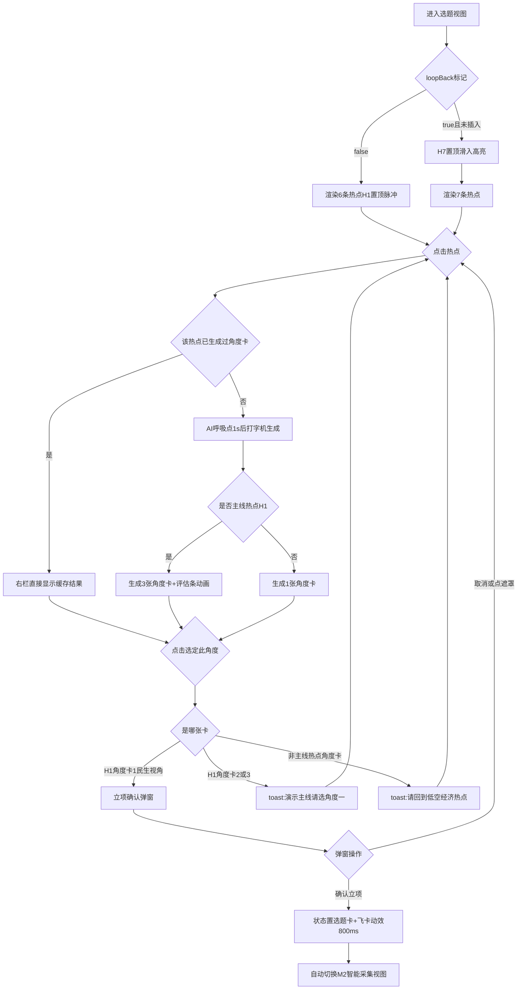

# 模块 PRD：M1 智能选题

| 项目 | 内容 |
|------|------|
| 文档版本 | v2.1（立项后流转至双轨智能采集） |
| 上游文档 | `prd/PRD-智媒编辑部-整体方案.md` §5.2 |
| 数据来源 | `00-叙事主线与全局数据字典.md` D1（D1-A/B/C/D）、D0（角色：责任编辑 林之桐） |
| 视图 ID | `view-topics` |
| 演示话术锚点 | 痛点：记者每天 2-3 小时刷十几个平台找线索，选题会凭经验决策 |

---

## 一、模块定位与功能分析

选题是新闻生产的起点和"第一个专业判断"。本模块要同时证明三件事：

1. **AI 聚合价值**：热点雷达替代"人工刷平台"——信息获取的效率革命；
2. **AI 评估价值**：角度卡的三维评估把"凭经验"变成"有据可依"——但评估只是建议；
3. **人的决策权**：立项是编辑的签名动作。这是全场第一个"人工把关点"，必须做出仪式感（确认弹窗 + 选题卡预览），为 M4 签发的重头戏做铺垫。

**功能分析——为什么是这四个功能**：
- 热点雷达（信息输入）→ 角度卡（AI 加工）→ 立项弹窗（人工决策）→ 闭环插入（系统反哺），四者构成"输入-加工-决策-反馈"完整回路，缺一则模块内逻辑不闭环；
- 不做：热点搜索、自定义抓取源配置、选题会协作评论——属正式产品功能，演示叙事不需要。

## 二、用户与场景

**角色**：责任编辑 林之桐（界面右上角色徽章）。

**场景 A：主线演示（动线第 2 步，约 90 秒）**
进入页面 → 热点列表已就位，H1"低空经济"置顶脉冲 → 演示者讲痛点（刷平台 2-3 小时）→ 点击 H1 → 右栏 AI 生成 3 张角度卡（讲解三维评估）→ 点击角度卡 1"选定此角度" → 立项弹窗预览选题卡 → 确认立项 → 飞卡动效 → 自动进入 M2 智能采集。

**场景 B：闭环返场（动线第 8 步，约 20 秒）**
从 M6 点击闭环按钮跳回 → H7 新线索置顶滑入 → 演示者收口："数据回到了选题，闭环完成。"

**场景 C：自由探索（问答备用）**
听众问"点别的热点会怎样" → 演示者点任意非主线热点 → AI 同样生成角度卡（D1-B 预置）→ 证明系统不是"单线剧本"。

**进入方式**：步骤条"选题"；M0 主线卡（线索态）；M6 闭环按钮。
**离开方式**：立项后自动进 M2 智能采集；步骤条跳转。

## 三、业务流程图



## 四、信息架构与关键界面

### 4.1 页面布局

```
┌────────────────────────────────────────────────────────────────┐
│ 全局导航栏（步骤条：选题=当前）                    [角色徽章:林之桐] │
├──────────────────────────┬─────────────────────────────────────┤
│ 左栏 热点雷达（40%）        │ 右栏 AI选题助手（60%）                │
│ ┌─ 标题"热点雷达"          │ ┌─ 空态：虚线框+提示文案              │
│ │  副标题"聚合12个平台…"   │ │   （或）                            │
│ ├─ [H7 闭环新线索]★仅闭环后 │ │  AI标识+呼吸点                     │
│ ├─ [H1 低空经济] 92 ↑脉冲  │ │  ┌角度卡1 民生视角────────┐        │
│ ├─ [H2 高考录取] 88 →      │ │  │建议标题/切入点          │        │
│ ├─ [H3 台风木兰] 85 ↑      │ │  │价值92 时效88 难度低     │        │
│ ├─ [H4 音乐节]   76 ↓      │ │  │      [选定此角度]      │        │
│ ├─ [H5 AI眼镜]   71 ↑      │ │  └────────────────────┘        │
│ └─ [H6 地铁33号] 64 →      │ │  ┌角度卡2 产业视角…┐┌角度卡3…┐    │
│                          │ └                                   │
├──────────────────────────┴─────────────────────────────────────┤
│ 页脚声明 ＋ 右下悬浮胶囊                                          │
└────────────────────────────────────────────────────────────────┘
```

### 4.2 热点条目解剖

| 元素 | 规格 | 数据 |
|------|------|------|
| 热度大数字 | 40px，≥85 红 `#EF4444` / 70-84 橙 `#F59E0B` / <70 灰蓝 `#8A94A8` | D1 heat |
| 标题 | 16px 单行截断 | D1 title |
| 来源标签 | 12px 胶囊 ×2-3 | D1 sources |
| 趋势迷你图 | 内联 SVG polyline 64×24px + 趋势箭头 | D1 spark 8 点 |
| 主线标记 | H1：红点脉冲（2s 循环）；H7：金色"来自效果洞察"徽标 + 脉冲光环 | isMain / isLoop |
| 选中态 | 品牌色 2px 描边 + 背景提亮 | 点击置换 |

### 4.3 角度卡解剖

| 元素 | 规格 | 数据 |
|------|------|------|
| 角度名徽章 | 品牌色胶囊 14px | D1-A/B 角度名 |
| 建议标题 | 18px 加粗，打字机输出 | D1-A/B 建议标题 |
| 切入点 | 14px 两行，打字机输出 | D1-A/B 切入点 |
| 三维评估条 | 三行横向进度条（新闻价值/时效性数值条 0-100；操作难度为低/中/高三段色块），文本完成后 600ms 动画 | D1-A/B 评估值 |
| 选定按钮 | 主按钮，卡片右下 | — |

## 五、功能清单

| 终端 | 模块 | 功能 | 描述 | 优先级 |
|------|------|------|------|--------|
| 演示Web端 | M1 | -热点雷达列表 | 6（+1）条热点渲染、分档配色、迷你趋势图、选中态 | Must |
| 演示Web端 | M1 | -AI角度卡生成区 | 空态/生成态/缓存态三态；主线 3 卡、非主线 1 卡 | Must |
| 演示Web端 | M1 | -立项确认弹窗 | 选题卡全字段预览 + 确认/取消 + 飞卡动效 | Must |
| 演示Web端 | M1 | -闭环新线索插入 | H7 置顶滑入 + 徽标 + 防重复 | Must |

## 六、需求功能详述

#### 6.1 热点雷达列表

**原型描述**：见 §4.1/4.2。列表容器标题下有伪实时标记：绿点 + "实时聚合中（演示数据）"。

**用户故事**：
> 作为责任编辑，我想要一屏看到全网热点及其趋势与来源，以便于把每天数小时的巡查工作压缩为一次浏览。

**前置条件**：无。

**交互逻辑明细**：

| 触发 | 行为 | 状态变更 |
|------|------|---------|
| 进入视图 | 按热度降序渲染 HOTSPOTS（loopBack 后 H7 恒置首位，不参与排序） | 无 |
| 点击热点条目 | 条目置选中态（互斥）；右栏触发角度卡逻辑（见 6.2） | `state.selectedHotspot` |
| 点击已选中条目 | 无操作（不清空右栏，防误触） | 无 |
| loopBack 首次进入 | H7 滑入动画（400ms，自上而下展开）+ 其余条目下移 | `state.loopInserted = true` |

**边界条件与异常处理**：
- 打字机生成中点击其他热点：当前任务 `abort()`，右栏立即切换新热点流程，无文本串扰；
- 列表 7 条以内无滚动；H7 插入后列表高度增加，超出容器时列表内滚动，H7 保持可见（插入时滚动到顶）。

**技术难点分析**：
- SVG polyline 点坐标由 spark 数组归一化计算（复用 `svgSparkline` 通用函数，M6 折线图同源）。

**验收标准 (Acceptance Criteria)**：
- 🎯 **成功场景**：进入后 6 条热点降序排列，H1 置顶带脉冲
- ✔️ **校验场景**：点击已选中的 H1，无重复触发
- ❌ **异常场景**：H1 角度卡生成中点击 H3，输出终止切换，无串扰

**测试用例**：
- 热度分档配色正确
- 迷你图与 spark 数据一致
- 选中态互斥切换
- 闭环后 H7 置顶带徽标

#### 6.2 AI 角度卡生成区

**原型描述**：
三态：
- **空态**：居中虚线框 + AI 图标 + "点选左侧热点，AI 为你生成报道角度与价值评估"；
- **生成态**：顶部"AI 选题助手正在分析【热点标题】…"+ 呼吸点 1s → 角度卡逐张打字机生成（卡间隔 300ms），每卡文本完成后评估条动画 600ms；
- **缓存态**：直接完整显示已生成卡片。

**用户故事**：
> 作为责任编辑，我想要 AI 对热点给出多角度评估建议，以便于选题决策有量化参考而不再纯凭直觉。

**前置条件**：已点击某条热点。

**交互逻辑明细**：

| 触发 | 行为 | 状态变更 |
|------|------|---------|
| 首次点击热点 X | 呼吸点 1s → 渲染 ANGLE_CARDS[X]（H1 三张 / 其他一张） | `generatedAngles[X] = true` |
| 再次点击热点 X | 跳过呼吸点与打字机，直接缓存态 | 无 |
| 生成中全局跳过（空格双击） | 所有卡即刻完整 + 评估条直接终值 | 无 |
| 点击"选定此角度" | 三分支：主线卡 1 → 立项弹窗；主线卡 2/3 → toast"本次演示主线为民生视角，请选择角度一"；非主线热点卡 → toast"演示主线请回到【低空经济】热点" | 无 |

**设计决策说明**：非主线"选定"按钮不做禁用灰态而做 toast 拦截——灰态会暴露"剧本感"，toast 则显得系统真实可用、只是演示动线受控。

**边界条件与异常处理**：
- H7（闭环线索）点击：右栏显示提示卡"该线索由效果洞察生成，可在下一场演示中立项追踪报道"——不提供角度卡（避免第二条线破坏叙事），同时给闭环故事一个合理承接；
- 评估条动画期间点击选定：正常响应（不锁定，动画纯装饰）。

**验收标准 (Acceptance Criteria)**：
- 🎯 **成功场景**：点击 H1，呼吸点后 3 卡依次生成、评估条动画完成
- ✔️ **校验场景**：点击角度卡 2 选定，toast 提示且不弹立项窗
- ❌ **异常场景**：生成中空格双击，3 卡立即完整呈现

**测试用例**：
- 主线 3 卡非主线 1 卡
- 评估条数值与字典一致
- 缓存态不重播动画
- 三分支拦截逻辑正确
- H7 显示承接提示卡

#### 6.3 立项确认弹窗

**原型描述**：
480px 居中模态（遮罩 60% 黑）。标题"生成选题卡"。主体为选题卡样式预览（D1-C 全字段）：选题标题、角度、核心问题、公开资料需求、原创采访需求、采访对象、记者张倩。底部：次按钮"取消" + 主按钮"确认立项"。确认后：弹窗关闭 → 选题卡缩小飞向步骤条"采集"节点（800ms 贝塞尔曲线）→ "采集"节点亮起 → 切换 M2。

**用户故事**：
> 作为责任编辑，我想要立项前预览完整选题卡并显式确认，以便于对这个选题决策负责——立项是我的签名，不是 AI 的。

**前置条件**：点击了 H1 角度卡 1 的"选定此角度"。

**交互逻辑明细**：

| 触发 | 行为 | 状态变更 |
|------|------|---------|
| 确认立项 | 按钮立即禁用（防双击）→ 飞卡动效 → 切 M2 | `storyStatus='选题卡'`、`currentStep='collection'` |
| 取消 / 点遮罩 / Esc | 关闭弹窗，回角度卡区 | 无 |

**边界条件与异常处理**：
- 飞卡动效期间全局点击屏蔽（800ms）；
- 已立项后（storyStatus 非"线索"）再次进入 M1：H1 条目右侧显示绿色"已立项"角标，角度卡 1 的选定按钮变为"已立项 ✓"禁用态——防演示者误操作二次立项（模块内状态闭环）。

**验收标准 (Acceptance Criteria)**：
- 🎯 **成功场景**：确认后飞卡动效完成、进入 M2、M0 卡片流转采集列
- ✔️ **校验场景**：取消后无状态变更，可重新点选
- ❌ **异常场景**：快速双击确认，仅流转一次

**测试用例**：
- 选题卡字段与 D1-C 一致
- 三种取消途径均无副作用
- 双击防重生效
- 立项后返回显示已立项态

#### 6.4 闭环新线索插入

**原型描述**：
H7《低空物流安全监管：谁来为天空立规矩》置顶滑入，金色徽标"来自效果洞察"，脉冲光环 3 个循环后转常态高亮。

**用户故事**：
> 作为编辑部负责人，我想要复盘产生的选题建议自动回到选题池顶部，以便于"数据反哺选题"是一次真实发生的流转而非一页 PPT。

**前置条件**：`state.loopBack === true`（M6 闭环按钮已点击）。

**交互逻辑明细**：

| 触发 | 行为 | 状态变更 |
|------|------|---------|
| loopBack 后首次进入 M1 | H7 滑入置顶 | `loopInserted = true` |
| 后续进入 | H7 常驻置顶，无重复插入动画 | 无 |
| 点击 H7 | 右栏承接提示卡（见 6.2 边界） | 无 |
| 重置 | H7 移除 | 出厂 |

**验收标准 (Acceptance Criteria)**：
- 🎯 **成功场景**：闭环跳回后 H7 置顶滑入带徽标
- ✔️ **校验场景**：切走再切回，H7 仍在且不重播插入动画
- ❌ **异常场景**：重置后 H7 消失、列表还原 6 条

**测试用例**：
- 插入动画单次播放
- 徽标与光环样式正确
- 重置后列表还原

## 七、状态与数据依赖

| 方向 | 内容 |
|------|------|
| 读取 | `HOTSPOTS`、`ANGLE_CARDS`、`TOPIC_CARD`、`LOOP_HOTSPOT`、`state.loopBack`、`state.storyStatus`（已立项判断） |
| 写入 | `storyStatus: 线索→选题卡`、`currentStep`、`generatedAngles`、`selectedHotspot`、`loopInserted` |
| 上游依赖 | M6 闭环按钮（loopBack） |
| 下游供给 | M2 的公开资料需求、原创采访需求、采访对象与核心问题；M3 选题上下文；M0 主线卡标题 |
