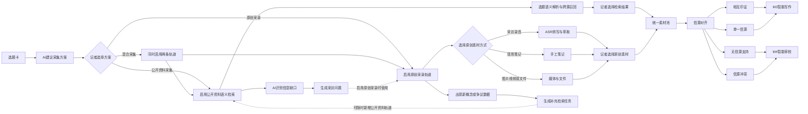
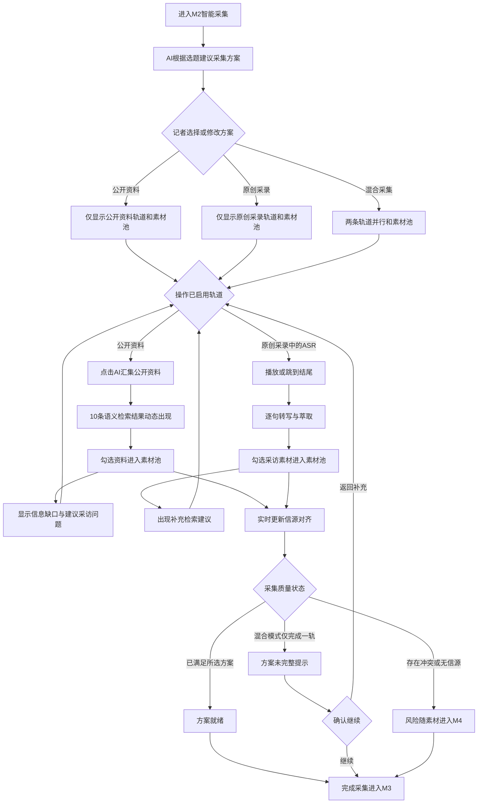

# 模块 PRD：M2 智能采集

| 项目 | 内容 |
|------|------|
| 文档版本 | v3.5（补充ASR置信度、重点提炼与采访知识图谱） |
| 上游文档 | `prd/PRD-智媒编辑部-整体方案.md` |
| 数据来源 | `00-叙事主线与全局数据字典.md` D2-P / D2-X / D2-A / D2-B / D2-U |
| 视图 ID | `view-collection` |
| 当前角色 | 记者 张倩 |
| 演示话术锚点 | “采”不等于录音转写，而是公开资料与原创采访并行汇集、相互追问、交叉核实 |

---

## 一、需求背景

### 1.1 当前缺口

原 M2 仅覆盖采访录音、实时转写和采访素材萃取，实质上是“采访助手”，没有覆盖新闻采集中的另一条主干：政策文件、公开数据、企业资料与历史报道的搜集和核实。

真实采编中，选题所需的采集方式并不固定：

- 资料综述、政策解读、数据服务稿可以只使用公开资料采集；
- 人物报道、现场快讯可以只使用原创采录；
- 调查、解释性报道可同时启用两条轨道；
- 原创采录也不等于 ASR，还可包含现场笔记、照片、视频与文件；ASR 只是本次 Demo 展示的一项能力。

当两条轨道同时启用时，它们不是先后阶段：

- 记者可以先采访，再针对新概念或争议数据补充检索；
- 公开资料发现的信息缺口会形成采访问题；
- 采访得到的新事实会反向触发公开资料回查；
- 两条轨道最终汇入同一素材池，由 AI 标记印证、冲突、单一信源与无信源状态。

因此 M2 必须从线性“采访流程”升级为并行“智能采集工作台”。

### 1.2 模块边界

- M1 回答“报道什么”：发现热点、生成角度、人工立项；
- M2 回答“这个选题需要怎么采、已经知道什么、还缺什么、证据在哪里”：按需启用公开资料和/或原创采录；
- M3 回答“如何写”：基于统一素材池生成并修改稿件；
- M4 回答“是否可信、能否签发”：使用多信源证据完成审校。

### 1.3 不做范围

- 不真实联网抓取网页；
- 不上传真实录音；
- 不做全文知识库、网页快照和版权管理；
- 不自动判定事实真伪，只输出信源关系与风险提示；
- 不把采访或 ASR 设为必经环节；
- 不设置“先完成公开资料才能采录”或“采录结束才能补充检索”的顺序门槛。

---

## 二、需求目标

| 编号 | 目标 | 衡量标准 |
|------|------|---------|
| G1 | 完整表达“采”环节 | 支持公开资料、原创采录、混合采集三种正常方案 |
| G2 | 按需组合且不强制采访 | 未启用原创采录时可直接完成；混合模式下两轨相互驱动 |
| G3 | 建立统一证据底座 | 所选轨道产生的素材进入统一素材池，保留来源、日期、类型与可信度 |
| G4 | 支撑写作与审校 | M3/M4 根据现有信源动态展示单源或多源证据，不要求两类信源同时存在 |
| G5 | 控制演示时长 | 主线演示 2分30秒内完成；快速路径 50秒内完成 |

---

## 三、业务流程

### 3.1 按需采集流程



### 3.2 页面操作流程



### 3.3 采集完成规则

完成条件依据记者选择的采集方案，而不是固定要求采访或 ASR：

| 状态 | 条件 | 是否可进入 M3 | 系统表现 |
|------|------|--------------|---------|
| 空素材 | 统一素材池为 0 | 否 | 完成按钮禁用 |
| 公开资料模式就绪 | 至少1项公开资料入池 | 是 | 绿色“公开资料采集完成” |
| 原创采录模式就绪 | 至少1项原创素材入池；不要求由 ASR 产生 | 是 | 绿色“原创采录完成” |
| 混合模式就绪 | 两类素材均存在 | 是 | 绿色“多信源就绪” |
| 混合模式未完整 | 仅一类素材存在 | 是，需确认 | 黄色提示“所选混合方案尚有一条轨道为空” |
| 存在风险 | 有冲突、单一信源或无信源项 | 是 | 风险标签随素材进入 M3/M4，不强制拦截 |

---

## 四、信息架构与功能清单

### 4.1 页面布局

```
┌─────────────────────────────────────────────────────────────────────────┐
│ 全局导航栏（步骤条：采集=当前）                            [记者 张倩] │
├─────────────────────────────────────────────────────────────────────────┤
│ 选题卡横幅 + 采集方案：[公开资料] [原创采录] [混合采集●]                 │
├─────────────────────────────────────────────────────────────────────────┤
│ 01 公开资料语义检索（上）                                                │
│ [自然语言检索框________________________] [开始语义检索]                  │
│ 语义解析 → 概念扩展 → 跨源召回 → 去重聚类 → 可信度排序                   │
│ 检索结果：官方/企业/媒体/学术/行业/公共数据卡片（相关性、命中片段、等级） │
│ AI识别信息缺口 → 加入原创采录提纲                                        │
├─────────────────────────────────────────────────────────────────────────┤
│ 02 原创采录（下）                                                        │
│ [采访录音/ASR] [现场笔记] [图片] [视频] [文件]                            │
│ 转写流与AI萃取　　　　　　　　　　　　已采录素材卡                         │
├─────────────────────────────────────────────────────────────────────────┤
│ 统一素材池与信源对齐：公开资料数量 / 原创素材数量 / 风险状态 [进入写作]  │
├─────────────────────────────────────────────────────────────────────────┤
│ 页脚：智媒编辑部 · AI新闻生产全流程工作台                                  │
└─────────────────────────────────────────────────────────────────────────┘
```

上述为混合采集布局。公开资料始终位于原创采录上方，符合从检索结果向采访提纲下传的阅读方向；原创采录产生补充检索任务时，页面滚动回上方并回填检索框。单轨模式隐藏未启用区，其他区域保持全宽。

### 4.2 信息层级

1. 选题上下文与采集质量状态；
2. 采集方案选择；
3. 当前启用的一条或两条采集轨道；
4. 混合模式下的跨轨联动提示；
5. 统一素材池与信源状态；
6. 完成采集操作。

### 4.3 功能清单

| 终端 | 模块 | 功能 | 描述 | 优先级 |
|------|------|------|------|--------|
| 演示Web端 | M2 | -选题卡横幅 | 显示选题、核心问题、资料需求、采访对象与采集质量状态 | Must |
| 演示Web端 | M2 | -采集方案选择 | AI建议并由记者选择公开资料、原创采录或混合采集 | Must |
| 演示Web端 | M2 | -语义检索输入 | 根据选题预填自然语言检索问题，支持推荐查询词 | Must |
| 演示Web端 | M2 | -动态检索过程 | 展示语义解析、概念扩展、跨源召回、去重聚类、可信度排序 | Must |
| 演示Web端 | M2 | -语义检索结果 | 展示10条多类型素材的相关性、来源、日期、等级、命中片段与可用事实 | Must |
| 演示Web端 | M2 | -信息缺口识别 | 根据公开资料生成采访问题 | Must |
| 演示Web端 | M2 | -原创素材入口 | 采访录音、现场笔记、图片视频、文件材料；Demo重点实现录音入口 | Must |
| 演示Web端 | M2 | -模拟采访ASR | 可选能力：播放/暂停/2x/跳到结尾/重播与16句转写 | Should |
| 演示Web端 | M2 | -采访知识图谱 | 识别人名、机构、业务与数据关系，快速呈现复杂关联 | Should |
| 演示Web端 | M2 | -追问建议 | 根据公开资料缺口与采访上下文更新问题 | Should |
| 演示Web端 | M2 | -采访素材萃取 | 提取要点6、金句2、关键数据5 | Must |
| 演示Web端 | M2 | -补充检索建议 | 采访出现新事实后生成回查任务 | Should |
| 演示Web端 | M2 | -统一素材池 | 汇总两类素材并保留信源元数据 | Must |
| 演示Web端 | M2 | -信源对齐 | 显示相互印证、单一信源、无信源与冲突状态 | Must |
| 演示Web端 | M2 | -完成采集 | 按采集质量状态直接进入或确认后进入 M3 | Must |

---

## 五、需求功能详述

#### 5.1 采集方案、选题横幅与状态

**原型描述**：
顶部通栏显示选题与 AI 建议采集方案；下方三个互斥方案按钮：公开资料、原创采录、混合采集。记者确认后渲染对应轨道；仍可通过“+增加资料采集”或“+增加原创采录”切换为混合模式。右侧状态根据当前方案显示：空素材 / 方案就绪 / 混合模式未完整 / 存在风险。

**用户故事**：
> 作为记者，我想要根据选题决定需要哪些采集能力，而不是被迫经过采访和 ASR。

**核心逻辑**：
- AI建议只作默认选中，记者可覆盖；
- 本演示主线默认 `hybrid`，但 `public` 与 `original` 都是完整正常流程；
- 关闭未产生素材的轨道可直接切换模式；已有素材的轨道关闭前需确认，确认后素材保留在池中但轨道隐藏；
- 状态由所选模式和统一素材池共同派生；
- 风险状态优先级高于就绪状态。

**验收标准**：
- 成功：选择公开资料模式并入池1项后显示“公开资料采集完成”，无采访警告；
- 校验：混合模式只有一轨素材时显示方案未完整提示；
- 异常：素材清空后状态恢复为空素材。

**测试用例**：
- 空素材状态正确
- 三种模式完成状态正确
- 公开资料模式不要求采访或ASR
- 双轨状态正确
- 风险状态优先

#### 5.2 公开资料语义检索与动态素材收集

**原型描述**：
根据选题卡预填自然语言查询“深圳 低空物流 配送 运营规模”。记者可改写查询或点击推荐查询词。点击检索后依次展示6个阶段：语义解析、概念扩展、跨源召回、语义去重、可信度与相关性排序、检索完成。完成后显示10张结果卡，字段包括相关性、标题、来源、类型、日期、信源等级、命中片段、可用事实与勾选状态。

**用户故事**：
> 作为记者，我想要围绕选题用自然语言进行语义检索，并看见素材如何被召回与排序，以便于动态扩展资料而不是读取固定资料包。

**核心逻辑**：
- 纯前端预置资料，不发网络请求；
- 不同查询词改变结果排序：安全/事故/监管/噪音查询优先召回安全指引、法规、保险和投诉数据；
- 检索过程必须可见，不允许点击后直接展示全部结果；
- AI 摘要不能脱离原卡来源单独进入素材池；
- 勾选资料卡后整张卡作为一个公开资料素材进入统一素材池；
- 点击“选择全部结果”后当前检索结果入池；
- 采访新事实触发补充检索时，查询词回填到上方输入框并重新排序；
- 再次进入保留检索词、阶段、结果和勾选状态。

**边界条件与异常处理**：
- 信源等级只表示来源类型，不表示事实已经核实；
- 所有公开资料卡显示真实来源网站、网站标识与可点击URL；
- 原创采录中的人物与数据不得冒充新华网、微博等真实网站来源。

**验收标准**：
- 成功：检索过程完成后10张多类型结果按相关性生成并可独立勾选；
- 校验：卡片字段与 D2-P 一致；
- 异常：生成中切换视图后返回显示完整终态。

**测试用例**：
- 六阶段检索过程顺序正确
- 十条结果字段完整
- 安全类查询改变排序
- 全选计数与当前结果数一致
- 取消勾选同步素材池
- 摘要与来源不可分离

#### 5.3 信息缺口与采访问题联动

**原型描述**：
公开资料卡下方显示“AI发现的信息缺口”。缺口卡包含：缺失信息、为什么需要、建议采访对象、生成问题。点击“加入采访提纲”后，问题进入原创采访轨道顶部的追问区。

**用户故事**：
> 作为记者，我想要 AI 从公开资料中识别未知项并生成采访问题，以便于采访不是重复询问已经公开的信息。

**核心逻辑**：
- 数据取 D2-X；
- 主线必生成三项：用户真实体验、运营统计口径、恶劣天气实际执行；
- 同一问题只可加入一次；
- 加入后缺口卡显示“已加入采访提纲”。

**验收标准**：
- 成功：用户体验缺口生成李婷采访问题；
- 校验：重复点击不重复加入；
- 异常：未生成公开资料时不显示缺口卡。

**测试用例**：
- 三项缺口正确
- 问题对象映射正确
- 防重复加入

#### 5.4 原创采录与可选 ASR

**原型描述**：
原创采录轨道先显示四个素材入口：采访录音、现场笔记、图片/视频、文件材料。采访录音入口进入本 Demo 的 ASR 展示：播放/暂停、2x、跳到结尾、时间码、波形与16句转写；其余三个入口使用预置素材卡模拟“已添加”，不实现文件系统。

**用户故事**：
> 作为记者，我想要按现场情况选择原创素材方式，并在有录音时使用 ASR，而不是被强制经过转写。

**核心逻辑**：
- 未选择采访录音时不渲染播放条和转写区；
- 现场笔记、图片视频、文件材料均可独立产生原创素材并满足原创采录模式完成条件；
- 句间延迟 = 名义时间差 × 0.35 ÷ speed；
- 暂停冻结下一句调度，当前句完成；
- 跳到结尾使16句和所有萃取项立即就位；
- 公开资料轨道的操作不影响采访播放状态；
- 采访播放时可以继续勾选公开资料。

**边界条件与异常处理**：
- 快速播放/暂停不得重复句；
- 切换视图自动暂停，返回后从断点继续。

**验收标准**：
- 成功：添加一条现场笔记即可完成原创采录模式，无需启动 ASR；
- 校验：跳到结尾后内容完整；
- 异常：连续切换播放状态无重复句。

**测试用例**：
- 四种原创素材入口可辨识
- 非ASR素材可独立入池
- 16句顺序正确
- 暂停恢复正确
- 跳结尾终态正确

#### 5.5 追问建议与补充检索

**原型描述**：
追问区同时接收两类建议：公开资料缺口生成的问题使用赭色“资料缺口”标记；采访上下文生成的问题使用蓝色“现场追问”标记。采访出现新事实后，公开资料轨道顶部出现洋红“补充检索任务”。

**用户故事**：
> 作为记者，我想要公开资料与采访互相触发下一步动作，以便于采集是持续核实而不是两套孤立工具。

**核心逻辑**：
- D2-B 的4条追问保留；
- D2-X 公开资料缺口问题可加入追问区；
- 采访出现“运营三年零伤人事故”后生成补充检索任务；
- 补充检索任务点击后显示“未发现公开佐证”，并将该事实标为单一信源。

**验收标准**：
- 成功：两类追问可同时显示并有来源标签；
- 校验：零伤人事故触发补充检索；
- 异常：补充检索不伪造检索结果。

**测试用例**：
- 两类建议样式可辨
- 触发句序正确
- 未找到佐证状态正确

#### 5.6 采访素材萃取

**原型描述**：
原创采访轨道下方按要点、金句、关键数据三个分组显示13项萃取结果，字段与 D2-B 一致。勾选后进入统一素材池，保留说话人和时间码。

**用户故事**：
> 作为记者，我想要 AI 萃取采访素材、由我决定是否入库，以便于素材选择权仍然在人。

**核心逻辑**：
- 萃取项按触发句序出现；
- 勾选/取消以统一素材池数组为唯一真源；
- “全部选中”只选择当前已出现的采访素材；
- 公开资料卡不计入采访分组数量。

**验收标准**：
- 成功：全部采访素材入库后采访计数为13；
- 校验：取消后计数同步；
- 异常：反复勾选不产生重复项。

**测试用例**：
- 13项完整
- 说话人与时间码保留
- 计数无漂移

#### 5.7 统一素材池与信源对齐

**原型描述**：
底部统一素材池显示分类计数“公开资料 10 / 原创采访 13”。素材项支持查看来源和移出素材池。下方按事实主题显示信源对齐卡：事实名称、公开资料证据、采访证据、状态标签。

**用户故事**：
> 作为记者，我想要看到同一事实在不同信源中的对应关系，以便于写作前发现证据强弱与冲突。

**核心逻辑**：
- 对齐规则取 D2-U；
- 日均1.2万单、132条/89个、12分钟、天气切换为相互印证；
- 三年零伤人事故为单一信源；
- 全国第一为无信源支持；
- 对齐状态随勾选实时重算；
- 公开资料、非ASR原创素材和ASR萃取项均可移出素材池；
- 尚未生成初稿时直接移出；已生成初稿时弹窗提示“将使初稿、审校及平台版本失效”；
- 确认移出后清空初稿、审校裁决、签发快照和平台版本，稿件状态回到采集；
- M3 和 M4 读取同一对齐结果，不复制计算逻辑。

**验收标准**：
- 成功：全选后显示4项印证、1项单一信源、1项无信源；
- 校验：取消 P2 后日均单量从双信源变为单一信源；
- 校验：已生成初稿后移出素材必须二次确认；
- 异常：删除全部相关素材后状态变无信源。

**测试用例**：
- 六事实对齐正确
- 状态随勾选重算
- 移出素材确认两分支
- 素材变化触发下游失效
- M3/M4读取一致

#### 5.8 完成采集

**原型描述**：
右栏底部固定按钮“完成采集，进入写作”。按钮上方显示采集质量摘要。

**用户故事**：
> 作为记者，我想要在看清当前信源结构后决定是否结束采集，以便于系统提示风险但不替我做决定。

**核心逻辑**：
- 统一素材池为0时按钮禁用；
- `public` 模式至少1项公开资料时直接进入 M3，不显示缺少采访警告；
- `original` 模式至少1项原创素材时直接进入 M3，不要求 ASR 已执行；
- `hybrid` 模式两类素材均存在时直接进入 M3；
- `hybrid` 模式仅完成一轨时弹确认：“当前混合采集方案尚有一条轨道为空。确认进入写作？”；
- 冲突、单一信源和无信源不拦截，风险标签随素材进入 M3/M4；
- 主线选择全部检索结果后统一素材池共23项，状态置 `素材就绪`。

**验收标准**：
- 成功：23项素材直接进入 M3；
- 校验：公开资料模式不触发采访缺失确认；
- 校验：仅混合模式缺轨时出现确认弹窗；
- 异常：0素材不能进入 M3。

**测试用例**：
- 零素材禁用
- public/original 模式直接流转
- hybrid 缺轨确认两分支
- ASR 未执行不影响 public 模式完成
- 风险状态正确传递

---

## 六、状态与数据依赖

| 方向 | 内容 |
|------|------|
| 读取 | `TOPIC_CARD`、`PUBLIC_SOURCES`、`RESEARCH_GAPS`、`TRANSCRIPT`、`EXTRACTS`、`SOURCE_ALIGNMENT` |
| 写入 | `collectionMode`、`enabledTracks`、`publicSourcesLoaded`、`selectedPublicSources`、`originalMaterials`、`interviewDone`、`selectedInterviewMaterials`、`materials`、`sourceAlignment`、`storyStatus: 选题卡→素材就绪` |
| 上游依赖 | M1 选题卡：公开资料需求、采访对象与原创采访需求 |
| 下游供给 | M3 统一素材池与溯源关系；M4 多信源事实核查依据 |

## 七、演示路径

### 7.1 主线（2分30秒内）

1. 进入页面，说明两条轨道并行；
2. 启动语义检索，观察6阶段过程，10条结果出现并全部选中；
3. 指出“用户体验缺口”自动进入采访提纲；
4. 播放采访前2句，展示1.2万单与追问建议；
5. 点击“跳到结尾”，全部采访素材就位并全选；
6. 指出右侧“1.2万单采访直接信源 + 公开规模参照”和“零事故单一信源”；
7. 完成采集进入 M3。

### 7.2 快速路径（50秒内）

1. 点击公开资料“全部生成并选中”；
2. 点击采访“跳到结尾并全选”；
3. 讲解信源对齐区；
4. 完成采集。
