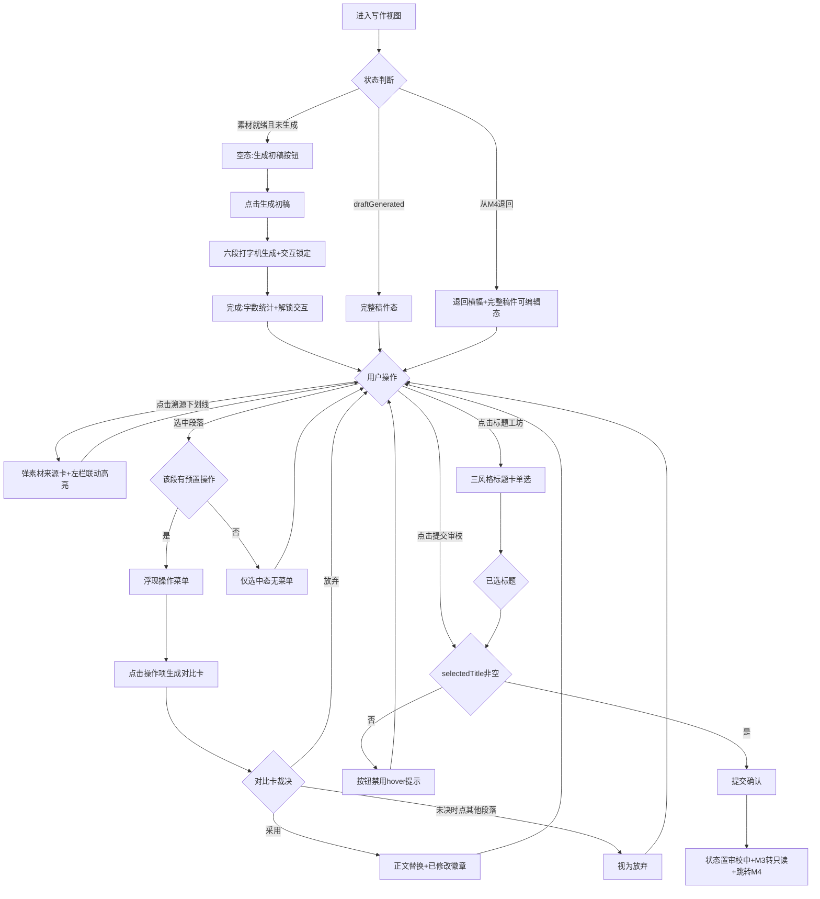

# 模块 PRD：M3 智能写作台

| 项目 | 内容 |
|------|------|
| 文档版本 | v2.2（补充结构化模板生成与多操作智能重构） |
| 上游文档 | `prd/PRD-智媒编辑部-整体方案.md` §5.4 |
| 数据来源 | `00-叙事主线与全局数据字典.md` D3（D3-A/B/C/D）、D4-A（退回文案）、D0（角色：记者 张倩） |
| 视图 ID | `view-writing` |
| 演示话术锚点 | 痛点：深度稿初稿约 1 天；立场：AI 初稿快但可能出错——所以需要"AI 核查 + 人工把关"双保险，而非"AI 代笔" |

---

## 一、模块定位与功能分析

写作是 AI 价值最直观、也最容易引发学界受众警惕的环节（"AI 会取代记者吗""AI 会编造事实吗"）。本模块的功能设计是一次"先扬后抑再扬"的叙事编排：

1. **扬——初稿生成**：850 字结构化初稿分钟级产出，效率冲击力；
2. **抑——主动暴露风险**：初稿预埋 4 处差错（其中"12 万单"是 AI 幻觉的典型样本）。演示者不在本环节点破（或仅在溯源弹卡中埋线），把揭晓留给 M4；
3. **扬——人机协同**：溯源标注（事实可回查）、段落级协同修改（对比确认制）、标题工坊（多案人选），证明记者始终是作者，AI 是助手。

**功能间逻辑闭环**：统一素材池（M2 的公开资料 + 原创采访）→ 初稿 → 多信源溯源 → 协同修改 → 标题 → 提交审校。另有 M4 退回 → 修改 → 再提交的回流分支。

**不做**：自由文本编辑（contenteditable）、自定义提示词写作、多稿件版本管理——演示动线不需要，且自由编辑会破坏预埋差错的剧情稳定性。

## 二、用户与场景

**角色**：记者 张倩（角色徽章）。

**场景 A：主线演示（动线第 4 步，约 3 分钟）**
进入见三栏 → 左栏显示公开资料10/原创采访13及信源状态 → 点"生成初稿" → 六段打字机成文 → 点击"12 分钟"弹出 P3 历史报道与采访 00:49 两条证据 → 选中导语点"精简" → 对比卡 → 采用 → 选网感标题 → 提交审校。

**场景 B：退回返工（M4 备用分支，演示主线不走）**
M4 总编点"退回修改" → 回到本视图，顶部红色退回横幅显示退回意见 → 演示者示意修改后重新提交 → M4 重新扫描。

**场景 C：AI 幻觉预警（可选彩蛋）**
演示者点击第2段“12万单”溯源下划线 → 弹卡显示采访00:12的“日均1.2万单”直接证据，以及21财经年度订单数据的行业规模参照并标明口径不同。

**进入方式**：M2 完成自动跳入；步骤条（fastForward）；M4 退回。
**离开方式**：提交审校进 M4；步骤条跳转。

## 三、业务流程图



## 四、信息架构与关键界面

### 4.1 页面布局

```
┌────────────────────────────────────────────────────────────────┐
│ 全局导航栏（步骤条：写作=当前）                      [角色徽章:张倩] │
├────────────────────────────────────────────────────────────────┤
│ （退回态专属）🔴 退回横幅：总编王一舟退回稿件·意见:第四段安全表述…    │
├───────────┬───────────────────────────────┬────────────────────┤
│ 左栏(22%)  │ 中栏 稿件区(52%)                │ 右栏 AI助手(26%)     │
│ ┌选题卡摘要┐│ ┌────────────────────────┐  │ ┌AI状态卡─────────┐ │
│ │标题/角度 ││ │ [（待定标题）] [标题工坊]  │  │ │"AI正在撰写…"/就绪 │ │
│ │核心问题 ─┤│ ├────────────────────────┤  │ ├对比卡区──────────┤ │
│ ├统一素材池(23)││ │ 纸张白底稿件区            │  │ │(选中段落操作后出现)│ │
│ │公开资料×10││ │ 导语:午后两点…【12分钟】   │  │ │ 原文(红底)        │ │
│ │采访素材×13││ │ 第2段:…【12万单】…       │  │ │ AI建议(绿底打字机) │ │
│ │信源对齐状态││ │ 第3段:…                 │  │ │ [采用] [放弃]     │ │
│ │(可折叠)  ││ │ …第6段                  │  │ └──────────────────┘ │
│ └─────────┘│ │ ─ 约850字·生成用时42s ─   │  │ [提交审校▸]（右下）   │
│            │ └────────────────────────┘  │                      │
├───────────┴───────────────────────────────┴────────────────────┤
│ 页脚声明 ＋ 右下悬浮胶囊                                          │
└────────────────────────────────────────────────────────────────┘
```

### 4.2 稿件区段落解剖

| 元素 | 规格 |
|------|------|
| 段落容器 | hover 浅色背景；点击选中 = 左侧 3px 品牌色竖条 + 背景常亮 |
| 溯源下划线 | 品牌色虚线下划线 span（`data-src` 键），hover 变实线 |
| 已修改徽章 | 段落右上角小徽章"已修改"（绿） |
| 操作菜单 | 选中段落上方浮条，仅显示该段预置的操作按钮 |

**段落 → 预置操作映射**（D3-C）：

| 段落 | 可用操作 |
|------|---------|
| 导语 | 精简 |
| 第 2 段（规模） | 无（保护预埋差错不被改写覆盖） |
| 第 3 段（效率） | 扩写 |
| 第 4 段（安全） | 无（保护预埋点 ②③④） |
| 第 5 段（用户） | 换风格 |
| 结语 | 改写 |

### 4.3 标题工坊弹层

横向三卡（严肃版/网感版/悬念版，D3-D），各含风格徽章 + 标题文本（打字机）+ 单选点选态。底部"采用所选标题"。

## 五、功能清单

| 终端 | 模块 | 功能 | 描述 | 优先级 |
|------|------|------|------|--------|
| 演示Web端 | M3 | -左栏上下文面板 | 选题卡摘要 + 统一素材池（公开/采访分类）+ 信源状态 | Must |
| 演示Web端 | M3 | -结构化模板生成 | 财经快讯、赛事战报、天气预警和深度报道模板 | Must |
| 演示Web端 | M3 | -AI初稿生成 | 六段打字机、溯源标注、字数统计、生成期交互锁 | Must |
| 演示Web端 | M3 | -溯源弹卡 | 稿件事实点 ↔ 素材双向联动 | Should |
| 演示Web端 | M3 | -段落协同编辑 | 扩写、降重、润色、短视频风格转换、多语种翻译 → 采用/放弃 | Must |
| 演示Web端 | M3 | -标题工坊 | 三风格生成单选 | Must |
| 演示Web端 | M3 | -提交审校 | 校验标题 → 流转 M4 → M3 只读 | Must |
| 演示Web端 | M3 | -退回横幅 | M4 退回时显示退回意见，支持重新提交 | Should |

## 六、需求功能详述

#### 6.1 左栏上下文面板

**原型描述**：见 §4.1。选题卡摘要区 + "统一素材池 (23)"：公开资料10项和原创采访13项分组；每个事实显示相互印证/单一信源/无信源标签。整栏可折叠为48px图标条。

**用户故事**：
> 作为记者，我想要写作时选题与素材随手可查，以便于稿件不偏题、事实不离source。

**前置条件**：storyStatus ≥ 素材就绪。

**交互逻辑明细**：

| 触发 | 行为 |
|------|------|
| 渲染 | 列表 = `state.materials`（跳跃进入时 fastForward 已填公开资料10项 + 采访素材13项） |
| 溯源弹卡打开 | 对应素材条目品牌色高亮 + 滚动可见 |
| 点击素材条目 | 稿件区对应溯源点闪烁定位（反向联动；无对应点的素材条目点击无动作） |
| 点击折叠钮 | 折叠/展开，中栏重排 |

**验收标准 (Acceptance Criteria)**：
- 🎯 **成功场景**：M2 全选后显示公开资料10项、原创采访13项及信源状态
- ✔️ **校验场景**：M2 部分归档时如实显示部分条目
- ❌ **异常场景**：折叠展开无布局错位

**测试用例**：
- 素材列表与 M2 统一素材池一致
- 公开资料与原创采访分组正确
- 双向联动定位正确
- 折叠态图标条可展开

#### 6.2 AI 初稿生成

**原型描述**：
空态主按钮按当前素材显示“基于选题卡与 {materials.length} 项素材生成初稿”。公开资料与原创素材数量分别取实时状态；public/original 模式不显示不存在的类别，也不阻止生成。主线 hybrid 示例为“公开信源10 · 原创信源13”。溯源 span 可关联一个或多个来源。

**用户故事**：
> 作为记者，我想要 AI 基于我采集的素材快速产出结构化初稿，以便于把一天的初稿时间压缩到分钟级、精力转向判断与打磨。

**前置条件**：进入视图且 `draftGenerated=false`。

**交互逻辑明细**：

| 触发 | 行为 | 状态变更 |
|------|------|---------|
| 点击生成 | 六段打字机开始；段落选中/标题工坊/提交按钮全部锁定 | 无 |
| 生成完成 | 解锁交互 + 字数条出现 | `draftGenerated=true` |
| 生成中空格双击 | 六段立即完整 + 完成回调正常 | `draftGenerated=true` |
| 生成中切走再返回 | abort 终态：六段完整呈现 | `draftGenerated=true` |
| 已生成再进入 | 直接完整稿件态 | 无 |

**内容红线**：四处预埋点（12 万单/全国第一/侯鸟/英文逗号）必须与 D3-A 逐字一致地出现在稿件中——实现与走查双重核对。

**验收标准 (Acceptance Criteria)**：
- 🎯 **成功场景**：六段生成完毕，四处预埋点在稿，字数条出现
- ✔️ **校验场景**：生成中段落点击无响应
- ❌ **异常场景**：生成中跳过/切走，终态完整、锁解除

**测试用例**：
- 六段顺序与内容一致
- 溯源 span 不破碎
- 生成期交互全锁
- 四处预埋点逐字核对

#### 6.3 溯源弹卡

**原型描述**：
点击溯源下划线 → 浮出多信源卡：事实主题、信源状态、公开资料证据、原创采访证据及各自回看入口。单一信源仅显示一栏并加黄色提示；无信源显示红色提示。同屏仅一张弹卡，左栏对应素材同步高亮。

**用户故事**：
> 作为记者，我想要稿件事实一键查看全部相关公开资料和原创采访证据，以便于判断证据强度并对数字负责。

**前置条件**：初稿已生成。

**交互逻辑明细**：

| 触发 | 行为 |
|------|------|
| 点击溯源点 | 弹卡（映射 D3-B）+ 左栏高亮 |
| 点击公开资料证据 | `showView('view-collection')` + 定位对应资料卡 |
| 点击采访证据 | `showView('view-collection')` + 定位对应转写句 |
| "12 万单"标注点 | 弹卡显示采访00:12为日均1.2万单；21财经为年度订单规模参照，明确不同口径，不作为直接印证 |
| 素材未归档（部分归档场景） | 弹卡显示黄色警示"该事实点未关联素材"——本身即是"无源事实"风险的演示点 |

**验收标准 (Acceptance Criteria)**：
- 🎯 **成功场景**：点击"12 分钟"显示 P3 历史报道与采访 00:49 两条证据
- ✔️ **校验场景**：点击"12 万单"弹卡带不一致警示
- ❌ **异常场景**：连续点击两个标注点同屏仅一卡

**测试用例**：
- D3-B 全部映射正确
- 公开资料与采访证据均可跳转定位
- 不一致警示条显示
- 未归档警示分支

#### 6.4 段落协同编辑

**原型描述**：
选中段落（§4.2）→ 操作菜单按映射表渲染 → 点击操作 → 右栏对比卡：上半原文（浅红底）、下半 AI 建议（浅绿底，打字机，D3-C 文本）、底部【采用】【放弃】。采用：中栏段落文本替换 + 绿色闪烁 + "已修改"徽章；对比卡收起。

**用户故事**：
> 作为记者，我想要对段落发起 AI 改写并比对后拍板，以便于文风与结构的最终决定权在我。

**前置条件**：初稿生成完毕且非只读态。

**交互逻辑明细**：

| 触发 | 行为 | 状态变更 |
|------|------|---------|
| 选中有操作段落 | 浮现菜单（映射 §4.2 表：导语精简/3段扩写/5段换风格/结语改写） | 无 |
| 选中无操作段落（2/4 段） | 仅选中态，无菜单（保护预埋点） | 无 |
| 点击操作项 | 右栏对比卡 + 建议文本打字机 | 无 |
| 采用 | 段落替换 D3-C 文本 + 徽章；建议文本中的溯源点保留可点击 | `state.paragraphEdits[段id]=true` |
| 放弃 | 对比卡关闭无变更 | 无 |
| 对比卡未决时选中其他段落 | 当前卡视为放弃关闭，再处理新选中 | 无 |
| 同段重复操作 | 对比卡仍显示 D3-C 预置文本（Mock 简化；讲稿避免重复演示） | 无 |

**验收标准 (Acceptance Criteria)**：
- 🎯 **成功场景**：导语精简采用后正文替换 + 徽章
- ✔️ **校验场景**：第 2 段选中无操作菜单
- ❌ **异常场景**：对比卡未决点其他段落，视为放弃无文本错乱

**测试用例**：
- 四段落菜单映射正确
- 采用替换与徽章生效
- 放弃无变更
- 预埋差错段不可操作

#### 6.5 标题工坊与提交审校

**原型描述**：见 §4.3。稿件顶部"（待定标题）"占位 + "标题工坊"按钮。选定后占位填充所选标题 + 风格小徽章。右栏底部主按钮"提交审校"（未选标题禁用 + hover"请先选定标题"）。点击提交 → 确认微弹窗"提交给总编王一舟审校？"→ 确认后状态流转 + 切 M4。

**用户故事**：
> 作为记者，我想要多风格标题供我选择、并显式提交送审，以便于标题决策和送审动作都有我的签名。

**前置条件**：初稿生成完毕。

**交互逻辑明细**：

| 触发 | 行为 | 状态变更 |
|------|------|---------|
| 打开标题工坊 | 首次：三卡打字机；再次：直接显示 | `state.titlesGenerated` |
| 单选某标题 | 点选态互斥 | 暂存 |
| 采用所选标题 | 弹层关闭、占位框填充 | `selectedTitle` |
| 提交审校（有标题） | 确认微弹窗 → 确认：流转 | `storyStatus='审校中'`、`currentStep='review'` |
| 提交后 | M3 转只读：段落不可选中、标题工坊隐藏、提交按钮变"审校中…"禁用 | `state.m3Readonly=true` |

**退回分支联动**（补全业务闭环）：M4 退回时 `storyStatus='草稿'`、`m3Readonly=false`，本视图顶部显示红色退回横幅（D4-A 文案），提交按钮文案变"修改后重新提交审校"；重新提交后 M4 侧 `reviewScanned=false`、`reviewDecisions={}`（重新扫描裁决）。

**验收标准 (Acceptance Criteria)**：
- 🎯 **成功场景**：选网感版提交，进入 M4
- ✔️ **校验场景**：未选标题提交禁用有提示
- ❌ **异常场景**：退回后横幅显示、可再提交、M4 重新扫描

**测试用例**：
- 三标题与 D3-D 一致
- 重复打开不重播
- 提交后 M3 只读
- 退回横幅与重提交流转正常

## 七、状态与数据依赖

| 方向 | 内容 |
|------|------|
| 读取 | `DRAFT_SECTIONS`、`SOURCE_MAP`、`REWRITES`、`TITLES`、`TOPIC_CARD`、`state.materials` |
| 写入 | `draftGenerated`、`selectedTitle`、`paragraphEdits`、`m3Readonly`、`storyStatus: 素材就绪→草稿→审校中`（及退回时 审校中→草稿）、`currentStep` |
| 上游依赖 | M2 统一素材池与信源对齐；M4 退回信号 |
| 下游供给 | M4 稿件文本（含预埋差错与用户修改）；M5 标题（selectedTitle） |
