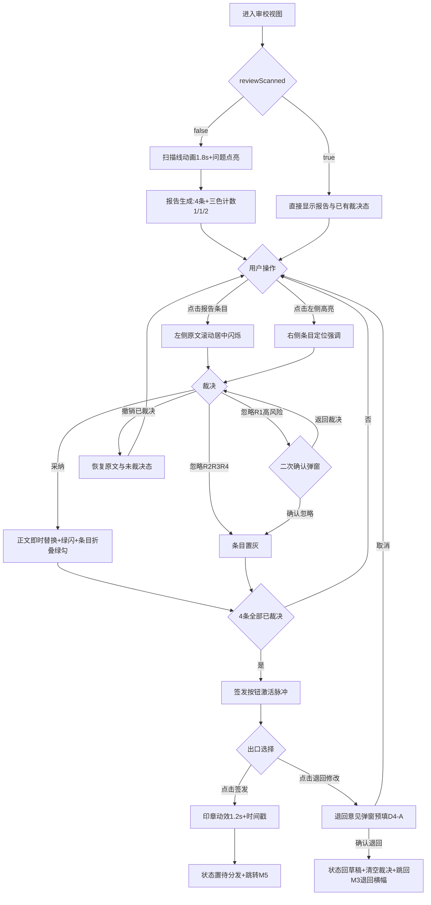

# 模块 PRD：M4 智能审校

| 项目 | 内容 |
|------|------|
| 文档版本 | v2.3（补充多模态影像甄别与版权校验） |
| 上游文档 | `prd/PRD-智媒编辑部-整体方案.md` §5.5 |
| 数据来源 | `00-叙事主线与全局数据字典.md` D4（问题清单）、D4-A（退回）、D0（角色：总编 王一舟） |
| 视图 ID | `view-review` |
| 演示话术锚点 | **全场高光模块**。痛点：三审三校人工通读 3 遍仍漏检；高光：AI 生成的稿子由 AI 查出差错、由人裁决——"双保险"；立场：把关权与签发责任永远在人 |

---

## 一、模块定位与功能分析

审核把关是新闻专业主义的核心堡垒，也是面向新闻院系受众最敏感的环节。本模块承载整场演示的剧情高潮——R1 事实核查揭晓：

- M3 生成的初稿写了"12 万单"（AI 幻觉样本）；
- M2采访00:12记录“日均1.2万单”，21财经提供年度订单规模参照但口径不同；
- M4将稿件、公开规模参照、原创采访三栏对齐并明确证据性质；
- 最终由总编裁决修正（人负最终责任）。

四个模块的数据链在这一刻闭合，这是"演示原型讲一个完整故事"的核心设计。

**功能构成**：扫描（AI 发现）→ 双向联动（问题定位）→ 裁决（人的判断，含撤销与高风险二次确认）→ 签发/退回（权力与责任的出口）。签发通道走主线，退回通道补全三审三校真实闭环（M3 回流）。

**不做**：多审级流程配置（一审二审三审角色切换）、审校规则管理、历史版本 diff——演示以"总编终审"一层浓缩三审三校叙事。

## 二、用户与场景

**角色**：总编 王一舟（角色徽章切换——前两模块是张倩，此处易人，把关链条的角色交接本身就是讲解点）。

**场景 A：主线演示（动线第 5 步，约 2 分 30 秒）**
进入 → 扫描线动画 → 报告 4 条问题（高1/中1/低2）→ 点 R1 → 左侧"12 万单"高亮居中 + 依据面板并排对比 → 演示者放慢节奏讲透"AI 幻觉被 AI 自己抓住" → 点【忽略】演示二次确认弹窗（"责任在人"话术）→ 取消 → 点【采纳修改】→ 正文闪烁修正 → 快速处理 R2-R4 → 签发按钮激活 → 点击 → 印章盖落 → 进入 M5。

**场景 B：退回演示（备用，问答环节展示）**
不签发，点"退回修改" → 填退回意见（预填 D4-A）→ 确认 → 跳回 M3 见退回横幅 → 证明系统支持真实的返工回路。

**进入方式**：M3 提交自动跳入；步骤条（fastForward）。
**离开方式**：签发进 M5；退回回 M3；步骤条跳转。

## 三、业务流程图



## 四、信息架构与关键界面

### 4.1 页面布局

```
┌────────────────────────────────────────────────────────────────┐
│ 全局导航栏（步骤条：审校=当前）                    [角色徽章:王一舟] │
├─────────────────────────────────┬──────────────────────────────┤
│ 左栏 稿件全文（55%）               │ 右栏 AI审校报告（45%）          │
│ ┌纸张白底────────────────────┐  │ ┌报告头──────────────────┐   │
│ │《你的咖啡，正在天上飞》        │  │ │AI审校完成·发现4处问题    │   │
│ │ 导语…                       │  │ │[高1] [中1] [低2]  维度标签│   │
│ │ …已达[12万单]🔴红底高亮…      │  │ ├R1卡 高风险·事实核查──────┤   │
│ │ …走在[全国第一]🟠橙底…        │  │ │摘录/建议/依据面板(默认开) │   │
│ │ …像[侯鸟]🟡黄底…             │  │ │稿件:12万单 ≠ 素材:1.2万单│   │
│ │ …骑手[,]🟡黄底…              │  │ │——陈明宇 录音00:12        │   │
│ │                    ┌签发章┐  │  │ │   [采纳修改] [忽略]      │   │
│ │  （签发后显示）      │签发  │  │  │ ├R2卡 中·表述规范─────────┤   │
│ │                    └─────┘  │  │ ├R3卡 低·错别字───────────┤   │
│ └────────────────────────────┘  │ ├R4卡 低·标点规范─────────┤   │
│                                 │ ├底部固定──────────────────┤   │
│                                 │ │已裁决 0/4 [退回修改][签发]│   │
├─────────────────────────────────┴──┴───────────────────────────┤
│ 页脚声明 ＋ 右下悬浮胶囊                                          │
└────────────────────────────────────────────────────────────────┘
```

### 4.2 问题卡解剖

| 元素 | 规格 |
|------|------|
| 左边框 | 4px 风险色（高红/中橙/低黄） |
| 头部 | 风险徽章 + 类型名（事实核查/表述规范/错别字/标点规范） |
| 原文摘录 | 等宽引用块，浅灰底 |
| AI 修改建议 | 绿色文本 + 前缀"建议：" |
| 依据说明 | 折叠区（R1 默认展开且为双栏对比样式；R2-R4 单行说明默认收起） |
| 裁决按钮 | 【采纳修改】主按钮 +【忽略】文字按钮 |
| 已裁决态 | 采纳：折叠单行"✓ 已采纳修改" + 撤销链接；忽略：置灰"— 已忽略" + 撤销链接 |

### 4.3 R1 多信源依据面板（高光设计）

三栏并排卡：

1. 稿件（红）：日均配送量已达 **12 万单**；
2. 公开资料（灰）：21财经为 **2024全年超20万单**，标注“口径不同，仅作规模参照”；
3. 原创采访（蓝）：陈明宇00:12表述为 **日均1.2万单**，标注“当前稿件直接信源”。

稿件栏与采访直接信源之间显示红色不等号；公开资料与采访之间不显示“相互印证”，而显示“统计口径不同”。公开资料栏提供“打开21财经来源”，采访栏提供“回看采访00:12”。

三栏是本次 hybrid 主线的表现，不是固定结构。若 M2 采用 public 模式，则渲染“稿件 + 公开资料”；original 模式渲染“稿件 + 原创素材”；只有单一可用证据时标记“单一信源”，无相关证据时标记“无信源支持”。M4 不要求采访或 ASR 数据存在。

## 五、功能清单

| 终端 | 模块 | 功能 | 描述 | 优先级 |
|------|------|------|------|--------|
| 演示Web端 | M4 | -AI扫描过场 | 扫描线 1.8s + 问题点亮 + 报告头计数 | Must |
| 演示Web端 | M4 | -稿件高亮区 | 四处三色高亮 + 与报告双向联动 | Must |
| 演示Web端 | M4 | -审校报告列表 | 4 张问题卡（R1 依据双栏默认展开） | Must |
| 演示Web端 | M4 | -虚构影像甄别 | 检查生成式影像特征、EXIF和摄影者信息 | Must |
| 演示Web端 | M4 | -版权自动比对 | 视觉指纹、相似素材和授权状态检查 | Must |
| 演示Web端 | M4 | -裁决与撤销 | 采纳/忽略/撤销、R1 忽略二次确认 | Must |
| 演示Web端 | M4 | -主编签发 | 进度门槛 + 印章动效 + 流转 M5 | Must |
| 演示Web端 | M4 | -退回修改 | 退回意见弹窗 + 回流 M3 + 裁决清空 | Should |

## 六、需求功能详述

#### 6.1 AI 扫描过场与报告生成

**原型描述**：
进入视图，左栏稿件（M3 最终文本，含用户已采用的改写）立即呈现。品牌色扫描线自上而下 1.8s，扫过处四个问题点依次亮起对应风险色高亮（伴 100ms 放大回弹）。扫描结束右栏报告头淡入："AI 审校完成 · 发现 4 处问题" + 三色计数徽章 + 四枚维度标签（事实核查/表述规范/文字差错/标点规范）+ 扫描用时"1.8 秒（演示）"。

**用户故事**：
> 作为总编，我想要 AI 先对全文完成多维扫描并结构化呈报，以便于我的三审三校从"通读找错"升级为"逐条裁决"。

**前置条件**：storyStatus = 审校中。

**交互逻辑明细**：

| 触发 | 行为 | 状态变更 |
|------|------|---------|
| 首次进入（reviewScanned=false） | 扫描动画 → 报告生成 | `reviewScanned=true` |
| 再次进入 | 直接显示报告 + 已有裁决态 | 无 |
| M3 退回后重新提交进入 | 重新扫描（reviewScanned 已被退回清空） | 重新置 true |

**边界条件与异常处理**：
- 扫描动画期间裁决按钮未渲染，无竞态；
- 稿件区文本 = M3 提交时快照（含协同修改结果），四处预埋点由 D3-C 设计保证不被改写覆盖。

**验收标准 (Acceptance Criteria)**：
- 🎯 **成功场景**：扫描后四处高亮、计数 1/1/2
- ✔️ **校验场景**：二次进入不重播扫描
- ❌ **异常场景**：退回重提后重新扫描、裁决清零

**测试用例**：
- 扫描单次播放
- 高亮颜色与风险级对应
- 退回重提触发重扫

#### 6.2 稿件高亮区与报告双向联动

**原型描述**：见 §4.1/4.2/4.3。

**用户故事**：
> 作为总编，我想要问题条目与原文位置一键互达，以便于每次裁决都在完整上下文中进行。

**前置条件**：报告已生成。

**交互逻辑明细**：

| 触发 | 行为 |
|------|------|
| 点击问题卡（任意位置非按钮） | 左侧对应高亮滚动居中 + 闪烁 2 次；卡片描边强调 |
| 点击左侧高亮 | 右侧对应卡滚动定位 + 描边强调 2s |
| 点击 R1“打开21财经来源” | 打开P9原始URL；联网不可用时仍显示卡片中的已收录片段 |
| 点击 R1"回看采访原文" | `showView('view-collection')` 定位第 2 句闪烁 |
| 连续快速点击多条 | 以最后一次为准（前次滚动中断） |

**验收标准 (Acceptance Criteria)**：
- 🎯 **成功场景**：点 R1 卡，"12 万单"居中闪烁、依据双栏可见
- ✔️ **校验场景**：点左侧 R3 高亮，右侧 R3 卡强调
- ❌ **异常场景**：快速连点 4 条无滚动抖动

**测试用例**：
- 四条双向联动全通
- R1 依据默认展开双栏样式
- 回看原文跳转定位正确

#### 6.3 裁决与撤销

**原型描述**：见 §4.2 已裁决态。R1 忽略二次确认弹窗文案：
> 「该问题与公开资料、原创采访两条信源同时矛盾。忽略后差错将随稿件发布，由签发人承担全部责任。确认忽略？」【返回裁决】【确认忽略】

**用户故事**：
> 作为总编，我想要逐条裁决且可反悔、高风险忽略被再次警示，以便于把关既高效又不失严肃性——AI 可以提建议，责任永远在我。

**前置条件**：报告已生成且未签发。

**交互逻辑明细**：

| 触发 | 行为 | 状态变更 |
|------|------|---------|
| 采纳 Rx | 左侧高亮文本替换为建议文本 + 绿闪 → 高亮转绿色下划线；卡片折叠"✓ 已采纳" | `reviewDecisions[Rx]='accepted'` |
| 忽略 R2/R3/R4 | 卡片置灰；左侧高亮转灰虚线下划线 | `reviewDecisions[Rx]='ignored'` |
| 忽略 R1 | 二次确认弹窗 → 确认才置灰；返回则无变更 | 确认时同上 |
| 撤销 | 恢复原文、高亮、未裁决卡片态；若签发已激活则回退禁用 | `reviewDecisions[Rx]=null` |
| 采纳 R1 | 正文"12 万单"→"1.2 万单"（此修正与 D5 各平台文案口径一致） | 同采纳 |

**边界条件与异常处理**：
- 二次确认遮罩点击 = 返回裁决；
- 撤销次数不限；
- 弹窗中 Esc = 返回裁决。

**验收标准 (Acceptance Criteria)**：
- 🎯 **成功场景**：采纳 R1 正文即时变"1.2 万单"并绿闪
- ✔️ **校验场景**：R1 忽略弹二次确认、取消无变更
- ❌ **异常场景**：撤销 R1 后正文恢复"12 万单"、签发回退禁用

**测试用例**：
- 四条采纳替换文本正确
- 低中风险忽略无确认弹窗
- 高风险确认弹窗两分支
- 撤销完整恢复

#### 6.4 主编签发

**原型描述**：
右栏底部固定条：进度"已裁决 x/4"（随裁决实时更新）+ 次按钮"退回修改" + 主按钮"签发"（x<4 时禁用灰态）。激活时轻微脉冲。点击签发后执行“纸稿切帧”转场：

1. 红色圆形"签发"印章旋转盖落稿件右下角（0.6s，印泥质感 + 落章震动）；
2. 签发信息行显示"签发人：总编 王一舟 · {当前时间}"并定格 300ms；
3. 稿件版面沿横向切分为矩形媒体帧；
4. 帧边缘由纸面栏线变为 3px 油墨黑描边，背景由暖白切换为 A5 发布黄 `#FFED00`；
5. 转场落定后进入 A5 五平台分发工作区（签发状态条 + 平台版本列表），M5 进入可操作状态。

完整转场 1.2s；全局跳过动画时直接进入 M5 稳定初态。

**用户故事**：
> 作为总编，我想要显式的签发动作和落章留痕，以便于"谁签发谁负责"在系统里有形有据。

**前置条件**：`Object.values(reviewDecisions)` 4 条均非 null。

**交互逻辑明细**：

| 触发 | 行为 | 状态变更 |
|------|------|---------|
| 第 4 条裁决完成 | 签发按钮解禁 + 脉冲 | 无 |
| 点击签发 | 按钮禁用 → 印章动效 → 纸稿切分为媒体帧 → 切 M5 | `storyStatus='待分发'`、`currentStep='channels'`、`m4Readonly=true` |
| 签发后再进入 | 只读：裁决记录可见、撤销链接隐藏、印章在稿、按钮"已签发 ✓" | 无 |
| 动效期间点击步骤条 | 排队至动效结束执行 | 无 |

**验收标准 (Acceptance Criteria)**：
- 🎯 **成功场景**：4/4 后签发激活，完成落章、切帧与黄底转场后进入 M5
- ✔️ **校验场景**：3/4 时签发禁用
- ❌ **异常场景**：签发后返回 M4 只读、撤销不可用

**测试用例**：
- 进度计数实时正确
- 门槛控制准确
- 印章、时间戳与纸稿切帧转场正常
- 跳过动画直接进入 M5 稳定初态
- 签发后只读

#### 6.5 退回修改（备用分支）

**原型描述**：
点击"退回修改" → 弹窗：标题"退回稿件至记者"，文本域预填 D4-A 退回意见（可编辑，Mock 不校验），底部【取消】【确认退回】。确认：弹窗关闭 → 跳回 M3（顶部红色退回横幅显示意见）。

**用户故事**：
> 作为总编，我想要可以退回稿件并附上意见，以便于审校不是"橡皮图章"，返工回路真实存在。

**前置条件**：报告已生成且未签发（裁决进度不限——总编可以不逐条裁决直接退回）。

**交互逻辑明细**：

| 触发 | 行为 | 状态变更 |
|------|------|---------|
| 确认退回 | 跳 M3 + 退回横幅 | `storyStatus='草稿'`、`currentStep='writing'`、`reviewDecisions={}`、`reviewScanned=false`、`m3Readonly=false`、`returnNote=意见文本` |
| 取消 | 关闭弹窗 | 无 |
| M3 重新提交后 | M4 重新扫描（见 6.1） | 循环闭合 |

**验收标准 (Acceptance Criteria)**：
- 🎯 **成功场景**：退回后 M3 显示横幅、M0 卡片回流写作列
- ✔️ **校验场景**：取消退回无变更
- ❌ **异常场景**：重提后 M4 重扫、旧裁决不残留

**测试用例**：
- 退回意见预填正确
- 状态回退与横幅联动
- 重提重扫裁决清零

## 七、状态与数据依赖

| 方向 | 内容 |
|------|------|
| 读取 | `REVIEW_ISSUES`、`SIGN_INFO`、M3 稿件快照（含 paragraphEdits 结果）、`state.reviewDecisions` |
| 写入 | `reviewScanned`、`reviewDecisions`、`m4Readonly`、`returnNote`、`storyStatus: 审校中→待分发`（或退回 →草稿）、`currentStep` |
| 上游依赖 | M3稿件与预埋差错；M2统一素材池、P9公开规模参照与采访证据句 |
| 下游供给 | M5（签发标题与修正后文本口径）；M3（退回信号） |
