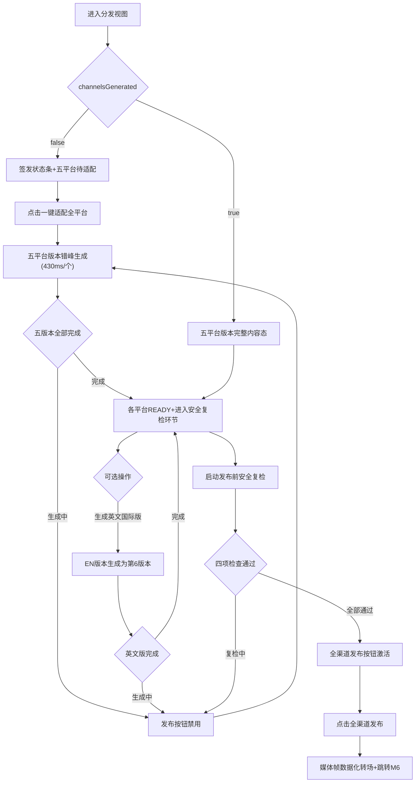

# 模块 PRD：M5 全渠道分发

| 项目 | 内容 |
|------|------|
| 文档版本 | v2.3（平台从 3 个扩展至 5 个；移除装饰性动态舞台，视觉体系融入功能组件） |
| 上游文档 | `prd/PRD-智媒编辑部-整体方案.md` §5.6 |
| 数据来源 | `00-叙事主线与全局数据字典.md` D5（D5-A/B/C/D/E/F）、D0（角色：责任编辑 林之桐） |
| 视图 ID | `view-channels` |
| 演示话术锚点 | 痛点：一稿适配 5 平台约 3 小时纯重复劳动；价值：AI 懂平台语态，人确认后一键发布 |

---

## 一、模块定位与功能分析

一稿多发是编辑部内最无争议的"纯重复劳动"，AI 替代它几乎没有伦理阻力——本模块是全场最轻松的环节，节奏可以快：

1. **五平台版本并行生成**是本模块的能力记忆点：公众号、微博、抖音、小红书、头条号五种平台语态依次就绪，风格差异一眼可辨；
2. **平台语态深度**证明产品对平台生态的理解（公众号的结构化深读 / 微博的一句话传播点 + 投票互动 / 抖音的口播分镜 / 小红书的"亲测"生活视角 / 头条号的要点前置信息流体）——这对懂传播的听众是"内行看门道"的加分项；
3. **英文国际版**呼应议程中两场国际传播人才培养演讲，是给这批听众的定制彩蛋；
4. **发布仍需人确认**：全渠道发布按钮由责任编辑点击，且发布前必须通过多模态安全复检，延续把关链。

**视觉原则（v2.3）**：不设置纯装饰元素（超大标题、装饰媒体帧、跑马灯等已移除）。发布黄 `#FFED00` 主场、3px 油墨黑边框、硬阴影的视觉语言只落在**功能组件**上：签发状态条、流程轨、平台列表、预览画布、发布检查面板。

**功能逻辑闭环**：签发稿件（M4 输入）→ 一键适配（AI 转换）→ 平台预览（人审阅）→ 安全复检（AI 复核）→ 发布（人确认）→ 流转 M6（数据回收）。

**不做**：定时发布、平台账号管理、发布参数配置（封面/摘要编辑）——正式产品功能。

## 二、用户与场景

**角色**：责任编辑 林之桐（角色徽章再次切换——记者写、总编签、编辑发，三角色接力完成把关链）。

**场景 A：主线演示（动线第 6 步，约 90 秒）**
进入页面见签发状态条 + 五个待适配平台 → 讲痛点（5 平台 3 小时）→ 点"一键适配全平台" → 五个平台版本错峰依次就绪 → 切换左侧平台，逐个点评语态差异（重点演示小红书"亲测视角"与抖音口播分镜）→ （可选）生成英文国际版 → 启动安全复检 → 四项通过 → 点"全渠道发布" → 转场自动进 M6。

**场景 B：快速带过（时间告急）**
进入 → 一键适配 → 安全复检 → 直接发布，跳过逐平台讲解。

**进入方式**：M4 签发自动跳入；步骤条（fastForward）。
**离开方式**：发布自动进 M6；步骤条跳转。

## 三、业务流程图



## 四、信息架构与关键界面

### 4.1 页面布局

```
┌────────────────────────────────────────────────────────────────┐
│ 全局导航栏（步骤条：分发=当前）                    [角色徽章:林之桐] │
├────────────────────────────────────────────────────────────────┤
│ 页头（单行紧凑）：全渠道分发 · 一稿多形说明          [适配状态 pill] │
├────────────────────────────────────────────────────────────────┤
│ 签发状态条：[签发章]《稿件标题》SIGNED BY 王一舟 ·      [n/5 就绪]  │
│            事实口径 1.2万单 · ONE STORY, EVERY SCREEN            │
├────────────────────────────────────────────────────────────────┤
│ 流程轨：✓稿件签发 → AI平台适配 → 安全复检 → 全渠道发布 → 数据回流A6 │
├──────────────┬────────────────────────────────┬────────────────┤
│ 平台版本列表   │ 平台预览（适配要点标签+平台画布）  │ 发布检查面板     │
│ 公众号        │                               │ 稿件签发 已完成  │
│ 微博          │  按所选平台仿真渲染               │ 事实口径 1.2万单 │
│ 抖音短视频     │  FRAME 01—05 编号             │ 平台版本 n/5    │
│ 小红书        │                               │ 英文国际版 可选  │
│ 头条号        │                               │ 安全复检四项     │
│ (EN 生成后插入)│                               │ [主操作按钮]    │
├──────────────┴────────────────────────────────┴────────────────┤
│ 页脚声明 ＋ 右下悬浮胶囊                                          │
└────────────────────────────────────────────────────────────────┘
```

### 4.2 平台版本规格

| 版本 | 结构与内容特征 | 内容（D5） |
|------|----------------|-----------|
| 01 公众号 | 深度图文：标题、重写导语、青色数据摘要条（日均/航线/覆盖/时长）、两个小节标题引导阅读、阅读原文与留言引导页脚 | D5-A |
| 02 微博 | 短讯传播：136/140 实时计数、一句话传播点、双话题标签、三选项投票组件（含比例条）、转评赞数据 | D5-B |
| 03 抖音短视频 | 口播脚本：5 镜 / 00:24 / 竖屏 9:16；三栏分镜表（镜头时长、画面、口播词逐镜写全）；字幕/BGM/结尾互动引导标注；黑底白字画布 | D5-C |
| 04 小红书 | 生活视角笔记："亲测"标题带 emoji、三宫格图片占位、体验式正文、场景要点清单（📍⏱💰🔊）、生活场景话题标签 | D5-D |
| 05 头条号 | 资讯速览：数字前置标题、"要点速览"三条框、通讯社体正文、关键词/推荐频道/来源标注 | D5-E |
| 06 EN 国际版（可选） | 英文标题与摘要、治理议题导向、来源标注 | D5-F |

页面共享元素：发布黄 `#FFED00` 背景；功能组件白底 + 3px 油墨黑边框 + 硬阴影；等宽字体元数据（FRAME 编号、READY 状态）；**不使用**装饰性大标题、跑马灯、玻璃拟态或常规后台卡片。

## 五、功能清单

| 终端 | 模块 | 功能 | 描述 | 优先级 |
|------|------|------|------|--------|
| 演示Web端 | M5 | -签发状态条 | 签发章、稿件标题、签发人、事实口径与就绪计数 | Must |
| 演示Web端 | M5 | -流程轨 | 签发→适配→复检→发布→回流五环节实时状态，常驻把关链提示 | Must |
| 演示Web端 | M5 | -一键多平台适配 | 五平台版本错峰生成（430ms/个） | Must |
| 演示Web端 | M5 | -平台版本列表 | 五平台图标、语态说明与 READY/GENERATING/WAIT 状态 | Must |
| 演示Web端 | M5 | -平台仿真预览 | 每平台按 §4.2 规格仿真渲染，附 3 条适配要点标签 | Must |
| 演示Web端 | M5 | -英文国际版 | 按需生成第 6 版本 | Could |
| 演示Web端 | M5 | -发布前安全复检 | 合规、事实口径、影像真实性和版权授权四阶段检查（发布前置条件） | Must |
| 演示Web端 | M5 | -全渠道发布 | 媒体帧数据化并流转 M6 | Must |

## 六、需求功能详述

#### 6.1 签发状态条与一键适配

**原型描述**：
页面不使用装饰横幅。签发状态以功能条呈现：左侧红色小签发章 + 《稿件标题》 + `SIGNED BY 王一舟 · 事实口径 1.2万单 · ONE STORY, EVERY SCREEN` 等宽元数据；右侧黄色状态块实时显示 `n/5 平台版本就绪`（发布后变 `已发布 5 平台`，含 EN 时计 6）。主操作按钮位于发布检查面板底部，三态为：`一键适配全平台` → `AI适配中 n/5` → `全渠道发布`。

**用户故事**：
> 作为责任编辑，我想要签发稿一个动作适配全部平台，以便于把 3 小时的复制粘贴改写压缩成一次点击。

**前置条件**：storyStatus = 待分发。

**交互逻辑明细**：

| 触发 | 行为 | 状态变更 |
|------|------|---------|
| 点击一键适配 | 按钮转生成中态；五平台按 430ms 间隔错峰就绪；列表项状态逐个变 READY；签发状态条计数同步 | 无 |
| 五版本全部完成 | 计数更新为 5/5；发布按钮保持禁用直至安全复检通过 | `channelsGenerated=true` |
| 生成中切走再返回 | abort 终态：五版本完整落位 | 同上 |
| 已生成再进入 | 直接完整态 | 无 |

**验收标准 (Acceptance Criteria)**：
- 🎯 **成功场景**：点击后五平台版本错峰就绪，计数更新为 5/5
- ✔️ **校验场景**：标题与 M3 选定一致；事实口径与 M4 裁决联动（1.2万单）
- ❌ **异常场景**：生成中切走再切回内容完整

**测试用例**：
- 三态按钮切换正确
- 五版本错峰节奏 430ms
- 流程轨环节状态与实际进度一致

#### 6.2 平台版本列表与仿真预览

**原型描述**：见 §4.2。左栏列出五个平台（图标底色：公众号黄 / 微博青 / 抖音洋红 / 小红书红 `#FF2442` / 头条白底黑字），每项含平台名、语态说明与等宽状态标识。点击切换中栏预览；预览工具栏显示平台名、内容规格说明与 `FRAME 01—05` 等宽编号；画布上方显示该平台 3 条**适配要点标签**（如小红书"记者视角转亲测视角"、头条"要点前置适配信息流"）。列表底部常驻 WHY 说明（5 平台约 3 小时人工基线）。

**用户故事**：
> 作为责任编辑，我想要按平台真实样式预览各版本，以便于确认 AI 的语态转换真的符合各平台生态而不是简单删减。

**前置条件**：一键适配已触发。

**交互逻辑明细**：

| 触发 | 行为 |
|------|------|
| 点击平台列表项 | 中栏切换为该平台仿真画布（公众号纸面 / 微博信号青底 / 抖音黑底 / 小红书笔记 / 头条资讯流） |
| 未生成时切换 | 画布显示"尚未生成平台版本"占位说明 |
| 生成完成 | 对应列表项状态变 READY |

**内容红线**：五版本文案与 D5-A/B/C/D/E 逐字一致；数据口径全部为修正后"1.2 万单"——若演示者在 M4 忽略了 R1（自由演示情形），文案联动为"12万单"（adapt 机制）。

**边界条件与异常处理**：
- 1440px 窄屏：三栏比例压缩（220px/自适应/260px），预览画布内边距收窄；
- 预览画布内容完整展示，不出现横向滚动。

**验收标准 (Acceptance Criteria)**：
- 🎯 **成功场景**：五平台完成后平台形态可辨识，语态差异一眼可辨
- ✔️ **校验场景**：微博计数器停在 136/140；抖音分镜合计 00:24
- ❌ **异常场景**：切换未生成平台显示占位而非报错

**测试用例**：
- 五平台版本平台特征逐项核对（含投票组件、三宫格、要点速览框）
- 文案与字典逐字一致
- 口径联动正确
- 适配要点标签与平台一一对应

#### 6.3 英文国际版（Could 级，可裁剪）

**原型描述**：
发布检查面板内显示"生成英文国际版"按钮。点击后 AI 翻译与本地化（约 850ms），完成后 EN 版本作为第 6 项插入平台列表并自动切换预览；发布检查"英文国际版"行由"可选"变"已生成"。生成期间发布按钮禁用。

**用户故事**：
> 作为责任编辑，我想要一键生成英文国际版，以便于同一稿件进入国际传播渠道——国际传播能力是本次听众高度关注的建设方向。

**前置条件**：五平台版本已就绪。

**交互逻辑明细**：

| 触发 | 行为 | 状态变更 |
|------|------|---------|
| 点击生成英文国际版 | 按钮转"AI正在翻译与本地化…"；完成后 EN 插入列表并切换预览 | `state.enGenerated=true` |
| 完成 | READY；发布按钮恢复；就绪计数变 6/6 | 无 |
| 不点击 | 五版本直接发布，EN 入口保持可选 | 无 |

**验收标准 (Acceptance Criteria)**：
- 🎯 **成功场景**：英文版完整生成并可预览
- ✔️ **校验场景**：不生成不影响发布
- ❌ **异常场景**：英文生成中发布禁用

**测试用例**：
- 入口时序控制正确
- 英文文案与 D5-F 一致
- 计数联动（5/5 → 6/6）

#### 6.4 发布前安全复检与全渠道发布

**原型描述**：
发布检查面板内的"发布前安全复检"分四阶段依次执行（360ms/项）：敏感词与合规 → 事实口径一致性 → 影像真实性 → 版权授权；全部通过前发布按钮禁用。点击"全渠道发布"后执行"媒体帧数据化"转场并流转 M6；流程轨"全渠道发布""数据回流 A6"环节点亮。

**用户故事**：
> 作为责任编辑，我想要发布前一次多模态复检、一次确认发布全部渠道，以便于错误不会在五个平台同步放大。

**前置条件**：全部已生成版本就绪且复检通过。

**交互逻辑明细**：

| 触发 | 行为 | 状态变更 |
|------|------|---------|
| 启动安全复检 | 四项依次检查，通过项显示 ✓ | `distributionChecked=true` |
| 点击发布 | 转场进入 M6 | `storyStatus='已发布'`、`published=true` |
| 发布后再进入 | 只读态：按钮"已发布 · 时间"禁用 | 无 |
| 双击发布 | 防重，仅一次 | 无 |

**验收标准 (Acceptance Criteria)**：
- 🎯 **成功场景**：复检四项通过后发布，自动进入 M6
- ✔️ **校验场景**：复检未通过前发布不可点
- ❌ **异常场景**：双击仅流转一次

**测试用例**：
- 复检四阶段节奏与状态渲染正确
- 发布 gating 正确（复检前禁用）
- 发布后只读
- 状态流转准确

## 七、状态与数据依赖

| 方向 | 内容 |
|------|------|
| 读取 | `WECHAT_VER`、`WEIBO_VER`、`DOUYIN_VER`、`XHS_VER`、`TOUTIAO_VER`、`EN_VER`、`state.selectedTitle`、M4 签发信息 |
| 写入 | `channelsGenerated`、`channelStage(0—5)`、`enGenerated`、`distributionChecked`、`published`、`storyStatus: 待分发→已发布` |
| 上游依赖 | M4 签发（签发状态条信息）；M3 标题 |
| 下游供给 | M6（发布完成信号，触发数据看板叙事成立；头条号/小红书作为 M6 次级传播节点回收数据） |
