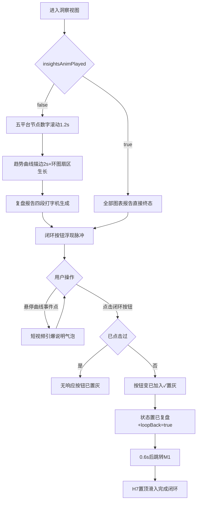

# 模块 PRD：M6 效果洞察

| 项目 | 内容 |
|------|------|
| 文档版本 | v2.4（传播网络升级为五平台主节点，与 M5 五平台分发对齐） |
| 上游文档 | `prd/PRD-智媒编辑部-整体方案.md` §5.7 |
| 数据来源 | `00-叙事主线与全局数据字典.md` D6（D6-A/B/C/D）、D0（角色：责任编辑 林之桐） |
| 视图 ID | `view-insights` |
| 演示话术锚点 | 痛点：数据散在各平台后台，周报半天起步，复盘难反哺选题；收口："数据回到了选题——这就是 AI 时代编辑部的完整闭环" |

---

## 一、模块定位与功能分析

M6 是演示动线的收束模块，承担双重任务：

1. **能力展示**：多平台数据自动汇聚 + AI 复盘分析——从"报表"到"洞察"的价值升级。关键设计是复盘报告的递进结构：传播亮点（发生了什么）→ 受众画像（谁在看）→ 追踪信号（评论区关切迁移：从"新奇"到"安全监管"）→ 追踪选题建议（下一步做什么）。AI 不止统计数据，而是从数据里"读出下一个选题"；
2. **叙事收口**：闭环按钮把追踪选题建议真实地送回 M1 热点雷达。整场演示从 M1 的"低空经济"热点开始，到 M6 生出"低空物流安全监管"新线索回到 M1 结束——业务闭环用一次真实的界面流转完成证明，这是 v1.0 方法论"实现产品业务闭环"的最终落点。

**追踪信号与新线索的因果链**（信息架构上必须可见）：复盘报告第三段指出评论区"安全/坠机/噪音/监管"关键词占比 17% → 第四段据此建议追踪选题 → 闭环按钮把该选题送入雷达。三步在页面上自上而下排列，逻辑链条肉眼可循。

**不做**：日期范围筛选、多稿件对比、导出报表——正式产品功能。

## 二、用户与场景

**角色**：责任编辑 林之桐。

**场景 A：主线演示（动线第 7-8 步，约 90 秒）**
M5 发布后，五个平台版本收缩为数据包落入 A6 传播网络的五个平台节点（公众号/微博/抖音/小红书/头条号，搜索与英文渠道为次级节点）→ 五条传播路径绘制、节点指标滚动（讲：不用再跑五个后台）→ hover 短视频节点展示"短视频引爆"信号 → 右侧 AI 信号解读生成 → 演示者讲解公众关切从"新奇"迁移到"安全与秩序" → 闭环按钮浮现 → 点击后黄色新选题数据包反向回到 M1，落为 H7 头条卡 → 收口话术 → （可选）开启教学视角做第二层收口。

**场景 B：数据讲解深入（问答备用）**
听众问数据来源/口径 → 悬停曲线事件点、环图扇区，展示细节气泡。

**进入方式**：M5 发布自动跳入；步骤条（fastForward）。
**离开方式**：闭环按钮回 M1（主线终点）；步骤条跳转。

## 三、业务流程图



## 四、信息架构与关键界面

### 4.1 页面布局

```
┌────────────────────────────────────────────────────────────────┐
│ 全局导航栏（步骤条：洞察=当前）                    [角色徽章:林之桐] │
├────────────────────────────────────────────────────────────────┤
│ 传播不是终点，而是信号的开始。                     [A6/SIGNAL FIELD] │
│  ┌──────────────传播网络场（65%）────────────┐ ┌AI信号解读（35%）┐ │
│  │ [签发稿源节点]──青色路径────[公众号 52,418]  │ │ 96.4万 / 182万 │ │
│  │       ├─────洋红路径───[微博 182万]        │ │ 17% 安全信号    │ │
│  │       ├─────紫色路径───[抖音 96.4万·引爆]   │ │ 受众关切迁移结论 │ │
│  │       ├─────品红路径───[小红书 8.4万]      │ │ 下一条选题建议   │ │
│  │       └─────钢蓝路径───[头条号 31.8万]     │ │[送回热点雷达 →] │ │
│  │ 次级：搜索/EN 虚线节点；黄色新选题数据包回流   │ └───────────────┘ │
├────────────────────────────────────────────────────────────────┤
│ 页脚声明 ＋ 右下悬浮胶囊                                          │
└────────────────────────────────────────────────────────────────┘
```

### 4.2 网络节点与信号规格

| 元素 | 规格 |
|------|------|
| 稿源节点 | 左侧白色半透明节点；呼吸光环；`SOURCE / SIGNED STORY` 等宽标识；标题、850 字、签发人与"5个平台版本" |
| 平台节点（5个） | 公众号、微博、抖音、小红书、头条号自上而下排列于右侧；各带平台色顶边、触达占比徽章（9/25/46/4/16%）、三项指标与平台结论；公众号/微博/抖音附 24h 迷你趋势线；抖音节点外挂"第7小时引爆"标旗 |
| 传播路径 | 内联 SVG 贝塞尔曲线 + 发光滤镜；公众号青 `#00A9BD`、微博洋红 `#FF3AA7`、抖音紫 `#705CFF`、小红书红 `#FF2442`、头条钢蓝 `#3978A8`；粗细按触达占比区分；进入页面时描边动画 |
| 次级节点 | 搜索引擎、英文渠道两个小节点，虚线路径连接 |
| 回流路径 | 黄色虚线 + 方形数据包由平台节点流回稿源，对应"新选题回流 M1"叙事 |
| 数据包 | 圆形信号点沿各路径移动（主路径可多颗错峰）；由 M5 平台版本转化而来 |
| AI 解读区 | 右侧独立栏；4 项 KPI + 受众关切迁移结论 + 追踪选题；不使用通用数据卡阵列 |
| 背景 | 冷白 `#F7FAF9` + 26px 点阵；节点 1px 冷灰描边 `#AAB9C0`；图例（内容信号/受众反馈/新选题回流）与 LIVE 徽章 |

## 五、功能清单

| 终端 | 模块 | 功能 | 描述 | 优先级 |
|------|------|------|------|--------|
| 演示Web端 | M6 | -传播网络场 | 稿源节点、五平台节点、次级节点、连接路径与动态数据包 | Must |
| 演示Web端 | M6 | -平台节点指标 | D6-A 指标按平台归入五个传播节点 | Must |
| 演示Web端 | M6 | -传播趋势路径 | D6-B 趋势映射为路径信号强度与短视频引爆事件 | Must |
| 演示Web端 | M6 | -AI信号解读 | KPI、受众关切迁移与追踪选题（D6-D） | Should |
| 演示Web端 | M6 | -闭环引导按钮 | 追踪选题送回 M1 热点雷达 | Must |

## 六、需求功能详述

#### 6.1 传播网络场与平台节点

**原型描述**：见 §4.1/4.2。左侧网络场包含一个签发稿源节点、五个平台节点（公众号、微博、抖音、小红书、头条号）和两个次级渠道节点（搜索引擎、英文渠道）。A5 转场产生的数据包沿五色贝塞尔路径移动并分别落入平台节点；节点落位后显示平台主指标、辅助指标与传播结论。节点使用半透明白底、1px 冷灰边框和等宽元数据，不使用常规数据卡阵列。

**用户故事**：
> 作为责任编辑，我想要各平台数据自动汇聚一屏，以便于不再登录五个后台手工拼周报。

**前置条件**：storyStatus ≥ 已发布。

**交互逻辑明细**：

| 触发 | 行为 | 状态变更 |
|------|------|---------|
| 首次进入 | 三条传播路径描边 → 三数据包落入节点 → 9 项指标在节点内错峰滚动 → AI 解读生成（动画链） | `insightsAnimPlayed=true` |
| 再次进入 | 全部直接终态（含报告与按钮） | 无 |
| 动画链任意时刻空格双击 | 全链跳至终态（路径完整、数据包落位、指标终值、AI 解读与按钮显示） | `insightsAnimPlayed=true` |

**验收标准 (Acceptance Criteria)**：
- 🎯 **成功场景**：三数据包落入对应平台节点，9 项指标滚动到位且与 D6-A 一致
- ✔️ **校验场景**：再次进入直接终态
- ❌ **异常场景**：滚动中切走再回，终态正确

**测试用例**：
- 三数据包与平台节点映射正确
- 九项数值与单位格式化正确
- 动画链单次播放

#### 6.2 传播路径与信号强度

**原型描述**：见 §4.2。

**用户故事**：
> 作为责任编辑，我想要看到传播的时间形态与渠道结构，以便于理解稿件"是怎么火起来的"、哪个渠道值得加码。

**前置条件**：M5 发布完成或通过 fastForward 进入 M6。

**交互逻辑明细**：

| 触发 | 行为 |
|------|------|
| 动画链到达 | 三条贝塞尔路径 1.2s 描边；数据包沿路径移动；节点依次亮起 |
| hover 路径 | 对应路径加粗；浮层展示该平台 24h 趋势摘要与曝光占比 |
| hover 短视频节点 | 展示"短视频引爆：金句片段被二次剪辑，1 小时内播放 +38 万" |
| hover 稿源节点 | 三条路径同时加亮，展示签发稿与三个版本的继承关系 |
| 窗口缩放 | viewBox 等比自适应不变形 |

**技术难点分析**：
- 贝塞尔路径端点必须与响应式节点位置一致；实现时由节点 DOM 坐标计算 SVG path，不写死像素端点。

**验收标准 (Acceptance Criteria)**：
- 🎯 **成功场景**：三路径描边与数据包移动完成，短视频节点可查看引爆说明
- ✔️ **校验场景**：五平台曝光占比总和为 100%（46+25+16+9+4）
- ❌ **异常场景**：缩放窗口图表不变形

**测试用例**：
- 三条路径颜色与平台映射正确
- 数据包落点与节点中心一致
- 短视频引爆说明正确
- 路径悬停联动正常

#### 6.3 AI 信号解读

**原型描述**：
右侧独立信号解读栏：顶部显示 `AI / SIGNAL INTERPRETATION` 等宽标识；中部 2×2 KPI（96.4 万视频播放、182 万社交曝光、17% 安全信号、25-34 核心受众）；下方以衬线大标题生成核心结论"公众关切已从新奇迁移到安全与秩序"；再依次生成 D6-D 四段内容。关键词"安全""坠机""噪音""监管"使用洋红信号标记；追踪选题使用黄色信号标记。

**用户故事**：
> 作为责任编辑，我想要 AI 从数据中读出公众关切的迁移并提出追踪选题，以便于复盘的产出是"下一步行动"而不是一页报表。

**前置条件**：五平台节点与指标动画完成（动画链）。

**交互逻辑明细**：

| 触发 | 行为 |
|------|------|
| 动画链到达 | KPI 显示 → 核心结论打字生成 → 四段详情生成 |
| 生成完毕 | 闭环按钮浮现（上滑淡入 + 脉冲） |
| 空格双击 | 报告立即完整 + 按钮浮现 |

**验收标准 (Acceptance Criteria)**：
- 🎯 **成功场景**：KPI、核心结论与四段解读完整；关键词为洋红信号，建议选题为黄色信号
- ✔️ **校验场景**：按钮在报告完成后才浮现
- ❌ **异常场景**：跳过后报告完整按钮在位

**测试用例**：
- 四段文案与 D6-D 一致
- 关键词与新选题信号色渲染正确
- 按钮浮现时序正确

#### 6.4 闭环引导按钮

**原型描述**：
信号解读栏底部显示黑底等宽按钮 `ROUTE NEXT STORY / 送回热点雷达 →`。点击后：按钮变 `ROUTED ✓` 并禁用；黄色新选题数据包从解读栏出发，沿网络路径反向移动至稿源节点；0.6s 后切换 M1，数据包落为 H7 头条卡并恢复铅字新闻纸面样式。

**用户故事**：
> 作为责任编辑，我想要一键把追踪建议送回选题池，以便于"数据反哺选题"是一次当着所有人发生的真实流转。

**前置条件**：复盘报告生成完毕。

**交互逻辑明细**：

| 触发 | 行为 | 状态变更 |
|------|------|---------|
| 点击（首次） | 按钮变 ROUTED → 黄色新选题数据包反向移动 → 0.6s 跳 M1 并落为 H7 | `loopBack=true`、`storyStatus='已复盘'` |
| 点击（已置灰） | 无响应 | 无 |
| 闭环后返回 M6 | 按钮保持"已加入 ✓"态 | 无 |
| 重置 | 按钮恢复（随全局出厂） | 出厂 |

**收口讲稿**（写入演示手册，非界面）："从热点发现到选题、采访、写作、审校、分发、复盘，再回到新的选题——AI 加速了每一个环节，但立项、裁决、签发、发布，每一个决定都是人做的。这就是我们理解的 AI 时代编辑部，也是各位的学生即将进入的工作现场。"

**验收标准 (Acceptance Criteria)**：
- 🎯 **成功场景**：黄色数据包反向移动后跳转 M1，并落为 H7 纸面头条卡
- ✔️ **校验场景**：重复点击无响应
- ❌ **异常场景**：闭环后回 M6 按钮保持已加入态

**测试用例**：
- 状态置已复盘
- loopBack 联动 H7 插入
- 黄色数据包到纸面头条的跨媒介转场正确
- 防重复生效
- 重置后按钮恢复

## 七、状态与数据依赖

| 方向 | 内容 |
|------|------|
| 读取 | `PLATFORM_STATS`、`TREND_POINTS`、`SHARE_RING`、`REVIEW_REPORT`、`state.selectedTitle`、`state.enExpanded`（信息条平台数 3/4） |
| 写入 | `insightsAnimPlayed`、`loopBack`、`storyStatus: 已发布→已复盘` |
| 上游依赖 | M5 发布（叙事前提）；M3 标题 |
| 下游供给 | M1（loopBack → H7 插入，全场闭环） |
