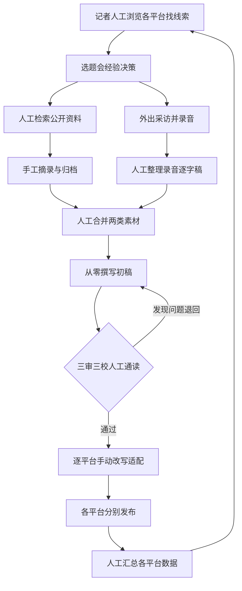
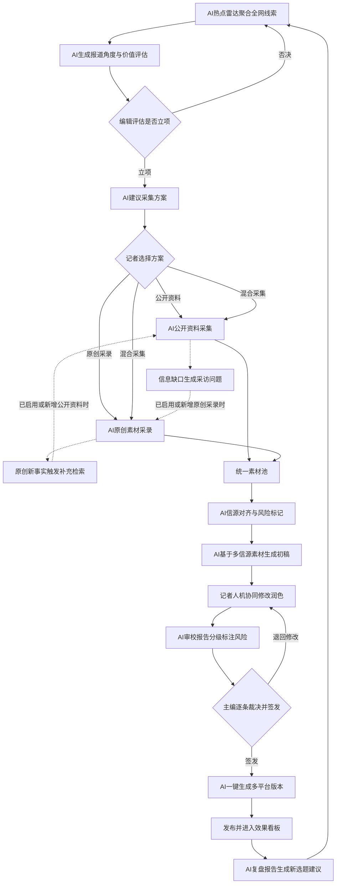

# 需求分析：「智媒编辑部」AI 新闻生产全流程演示原型（整体方案功能清单）

| 项目 | 内容 |
|------|------|
| 文档版本 | v1.3（M2支持动态语义检索与纵向单页采集） |
| 撰写日期 | 2026-07-18 |
| 演示场合 | 第六届全国新闻传播学院院长研修班（深圳大学传播学院承办） |
| 演示受众 | 全国新闻传播学院院长、副院长、教师、专家、管理者 |
| 关联文档 | `展示目标对象.md`、`演示原型方案初期分析v1.0.md`、`AI思考过程文档/会议主题拆解（fable5）.md` |
| 产品定位 | 行业工作流为体、人才培养为用：以真实新闻生产工作流为骨架的 AI 采编演示原型 |
| 技术路线 | HTML + CSS + 原生 JS，纯前端 Mock 脚本，零依赖，可离线演示 |

---

## 一、需求背景分析

### 1.1 需求来源

在第六届全国新闻传播学院院长研修班上进行现场演示。经议程拆解，全部 11 场主题演讲中 5 场直接讨论"AI × 人才培养/教育变革"，4 场讨论学科建设与学院管理，2 场讨论国际传播人才培养；行业元素仅以实地教学形式出现（深圳特区报业集团、华为、腾讯、深大国家级传媒实验教学示范中心）。

**结论**：受众的核心关切是"AI 时代新闻传播教育怎么改、学生该练什么、实验教学平台怎么建"。演示原型应从行业机制和工作流出发建立专业可信度，同时以人才培养视角收尾落点。

### 1.2 当前行业业务痛点（演示叙事的原材料）

新闻生产六环节的现状痛点：

| 环节 | 现状做法 | 核心痛点 | 痛感量级（演示话术口径，Mock） |
|------|---------|---------|------------------------------|
| 选题策划 | 记者人工刷十几个平台找线索，选题会凭经验决策 | 线索分散、监测滞后、判断主观 | 每天 2-3 小时刷平台，仍漏热点 |
| 资料与采访采集 | 记者分别检索政策/公开数据/历史报道，同时开展采访并手工整理；两类素材缺少统一关联 | 检索、采访、归档彼此割裂，难以及时发现信息缺口与信源冲突 | 1 小时录音约需 4 小时整理；公开资料需人工逐条摘录 |
| 写作 | 从零起笔，反复调整结构 | 初稿慢、重复劳动多 | 一篇深度稿初稿约 1 天 |
| 审核校对 | 三审三校人工通读 | 事实差错、敏感表述、错别字靠人眼，易漏 | 人工通读 3 遍仍有漏检 |
| 多平台分发 | 为每个平台手动改写标题、篇幅、风格 | 一稿多版纯重复劳动 | 5 个平台适配约 3 小时 |
| 效果复盘 | 各平台后台分别取数、手动汇总 | 数据分散，复盘难以反哺选题 | 周报制作半天起步 |

### 1.3 不做的影响

- 缺少可交互实物，演讲停留在理念层面，无法与议程中"参观国家级传媒实验教学示范中心"等实物化环节竞争注意力；
- 无法向院长受众具象化"学生未来的工作现场"，错失建立合作/共建实训平台意向的机会。

---

## 二、需求目标确认

| 编号 | 目标 | 衡量标准 |
|------|------|---------|
| G1 | 用一条新闻的完整旅程串起采编发全流程演示 | 8-10 分钟内完整走完六环节，叙事不中断 |
| G2 | 每个环节呈现"痛点 → AI 介入 → 人做最终把关"三段式 | 每个模块均有 AI 输出 + 人工采纳/否决交互 |
| G3 | 联结人才培养视角 | 全局"教学视角"开关，开启后每环节显示能力培养标注 |
| G4 | 演示绝对稳定 | 零依赖、可离线运行、一键重置，可连续多场演示 |

**核心设计原则**（贯穿所有模块）：

1. **人主导、AI 辅助**：所有 AI 输出必须经人确认才生效，体现新闻专业主义的"把关人"理念——这是面向新闻院系受众的关键立场；
2. **闭环叙事**：效果洞察反哺选题，形成生产闭环（对应 v1.0 方法论"实现产品业务闭环"）；
3. **演示优先**：视觉冲击力（打字机效果、流水线看板、并排对比）优先于功能完备性。

---

## 三、业务流程分析

### 3.1 当前流程（现状）

### 3.2 目标流程（AI 介入后）

关键人工责任节点包括立项、采集方案选择、素材入池、审校裁决与签发；AI负责建议、提取和对齐，不替代记者决定是否采访或使用ASR。

### 3.3 演示叙事主线（Demo Story）

一条虚构但贴合深圳语境的新闻贯穿全程：

> **选题**：《外卖从天而降：深圳低空经济如何改变城市生活》
> 线索来源：热点雷达捕捉"低空经济"话题热度飙升 → 编辑立项"民生视角观察" → AI 并行汇集政策/企业/历史资料，同时辅助采访企业负责人和市民 → 公开资料缺口生成采访问题，采访新事实触发补充检索 → 两轨素材进入统一素材池并完成信源对齐 → AI 生成初稿、记者协同修改 → 审校发现一处数据差错与一处表述风险 → 一键生成公众号/微博/短视频版本 → 效果洞察生成追踪报道"低空物流安全监管"→ 回到选题环节。

预埋剧情点（Mock 脚本中固定触发）：公开企业简报与采访口述均为"日均 1.2 万单"，AI 初稿却写成"12 万单"；M4 以稿件、公开资料、原创采访三栏证据完成核查。这是全场高光，证明多信源采集、AI 核查和人工裁决形成双保险。

---

## 四、功能拆解清单

### 4.1 功能清单

终端统一为"演示 Web 端"（桌面浏览器，1920×1080 投屏优化），故表中省略终端列。

| 模块 | 功能（页面/组件） | 功能描述 | 优先级 |
|------|------------------|---------|--------|
| M0 工作台 | 全局流程导航 | 顶部六环节步骤条，当前环节高亮，点击可跳转 | Must |
| M0 工作台 | 生产流水线看板 | 演示稿件以卡片形式在六环节间流转，状态实时更新 | Must |
| M0 工作台 | 编辑部数据概览 | 今日线索数、在产稿件、已发布量等 Mock 大屏数字，开场造势 | Could |
| M1 智能选题 | 热点雷达 | 聚合热点列表（Mock 全网数据），含热度趋势迷你图、来源分布、时间衰减 | Must |
| M1 智能选题 | AI 选题建议卡 | 对选中热点生成 3 个报道角度，附新闻价值/时效性/操作难度评估 | Must |
| M1 智能选题 | 选题立项 | 编辑选定角度生成选题卡，流转至采集环节 | Must |
| M2 智能采集 | 采集方案选择 | AI建议并由记者选择公开资料、原创采录或混合采集 | Must |
| M2 智能采集 | 公开资料语义检索 | 根据选题动态完成语义解析、概念扩展、多源召回、去重和可信度排序 | Must |
| M2 智能采集 | 语义检索结果 | 展示10条多类型素材的相关性、命中片段、来源、日期、等级与可用事实 | Must |
| M2 智能采集 | 信息缺口与采访联动 | 公开资料缺口生成采访问题；采访新事实触发补充检索 | Must |
| M2 智能采集 | 原创采录 | 支持采访录音、现场笔记、图片视频与文件；ASR为可选能力 | Must |
| M2 智能采集 | 实时转写与萃取 | 选择采访录音时模拟ASR并提取要点、金句与关键数据 | Should |
| M2 智能采集 | 统一素材池 | 汇总公开资料和原创采访素材，保留信源元数据 | Must |
| M2 智能采集 | 信源对齐 | 标记相互印证、单一信源、无信源与冲突状态 | Must |
| M3 智能写作台 | AI 初稿生成 | 基于选题卡与多信源统一素材池，打字机生成结构化初稿 | Must |
| M3 智能写作台 | 人机协同编辑 | 选中段落触发改写/扩写/精简/换风格操作，修改前后对比 | Must |
| M3 智能写作台 | 标题工坊 | 生成严肃版/网感版/悬念版多风格标题供人选择 | Must |
| M3 智能写作台 | 引用溯源 | 稿件事实点标注素材来源，点击回看原始素材 | Should |
| M4 智能审校 | AI 审校报告 | 稿件与公开资料/原创采访多信源比对，叠加表述与文字审校 | Must |
| M4 智能审校 | 逐条裁决 | 每条问题提供"采纳修改/忽略"操作，体现人工终审 | Must |
| M4 智能审校 | 主编签发 | 全部裁决完成后签发，稿件流转分发环节 | Must |
| M5 全渠道分发 | 一键多平台适配 | 同一稿件生成公众号推文/微博短讯/短视频口播脚本三版本 | Must |
| M5 全渠道分发 | 动态媒体帧 | 公众号、微博、短视频三个倾斜媒体帧并行生成与发布 | Must |
| M5 全渠道分发 | 英文国际版 | 生成面向国际传播的英文版本（呼应议程国际传播议题） | Could |
| M6 效果洞察 | 数据网络场 | 稿源节点、平台节点、传播路径与动态数据包 | Must |
| M6 效果洞察 | AI 信号解读 | 生成传播分析、受众关切迁移与追踪选题 | Should |
| M6 效果洞察 | 闭环引导 | "洞察反哺选题"入口，引导回 M1，完成业务闭环 | Must |
| G 全局 | 教学视角开关 | 全局开关，开启后每模块浮层显示对应培养能力/课程建议/考核点 | Should |
| G 全局 | 演示一键重置 | 恢复全部初始状态，支持连续多场演示 | Must |
| G 全局 | 打字机输出引擎 | 统一的 AI 输出逐字上屏效果组件，所有模块复用 | Must |

### 4.2 技术边界

- **纯前端 Mock**：所有 AI 输出为预置脚本，打字机效果模拟生成过程；无任何网络请求、无后端、无第三方库；
- **运行方式**：双击 `index.html` 即可运行，兼容 Chrome/Edge；
- **数据体量**：Mock 数据（热点列表、访谈逐字稿、稿件文本、审校问题、平台版本、图表数据）全部内置于 JS 数据文件；
- **不做**：登录鉴权、真实音频播放（用模拟播放条代替）、移动端适配、数据持久化（刷新即重置亦可接受，但提供显式重置按钮）。

---

## 五、待确认事项

| 序号 | 待确认事项 | 状态 | 说明 |
|------|------------|------|------|
| 1 | 演示主线选题《深圳低空经济》是否合适 | 待确认 | 也可换为其他贴近深圳、正面安全的题材 |
| 2 | 产品名称「智媒编辑部」是否采用 | 待确认 | 亦可用其他命名，影响界面 Logo 与讲稿 |
| 3 | 教学视角标注的具体文案（对应课程名/能力项） | 待确认 | 可在模块级 PRD 阶段细化，建议参考发言人议题措辞 |
| 4 | 英文国际版（Could 级）是否纳入首版 | 待确认 | 若演示时长紧张可砍 |
| 5 | 演示设备与投屏分辨率 | 待确认 | 默认按 1920×1080 设计 |

**确认原则**：以上均不阻塞整体 PRD 撰写；第 1、2 项需在模块级 PRD 撰写前确认，因其影响全部 Mock 文案。
