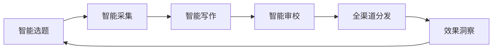

# 「智媒编辑部」演示说明书

## 一、方案价值

### 1. 行业工作流与人才培养相结合

本方案不是单点AI工具合集，而是以真实新闻生产机制为骨架，将选题、采集、写作、审校、分发和效果洞察串成一条完整工作流。

面向新闻传播学院院长、教师和管理者，演示重点不是“AI能替人做什么”，而是：

- 学生未来将进入怎样的智能编辑部；
- 新闻专业能力如何在人机协作中重新定义；
- 课程、实训平台和实验室可以训练哪些具体能力；
- 如何在提高效率的同时保留新闻专业主义和责任链条。

### 2. AI参与每个环节，但关键决定由人完成

系统中的AI负责：

- 监控全网数据；
- 发现热点和趋势；
- 聚合资料与提炼采访内容；
- 生成和重构文本；
- 发现事实、合规、影像和版权风险；
- 适配多平台内容；
- 从传播数据中提出下一条选题。

人负责：

- 决定是否立项；
- 选择哪些资料进入素材池；
- 判断AI改写是否采用；
- 裁决审校问题；
- 承担签发责任；
- 确认最终发布；
- 决定是否启动追踪报道。

核心立场是：**AI提高采编效率，记者和编辑保留判断权、把关权和责任。**

### 3. 建立从线索到新线索的业务闭环

完整流程如下：

传播效果不会停留在数据报表，而是重新生成追踪选题，回到热点雷达，形成“生产—传播—反馈—再生产”闭环。

### 4. 强化信源、事实与版权安全

公开资料使用深圳政府在线、新华网、中国民用航空局、21财经、微博等可核验网站，并保留来源链接。

系统同时展示：

- 公开资料与原创采访的区别；
- 直接信源与行业参照的区别；
- 事实冲突与无充分信源状态；
- 虚构影像甄别；
- 图片版权和授权状态；
- 高风险问题的人工二次确认。

### 5. 具备实验教学转化价值

各模块可对应不同课程：

- 智能选题：新闻敏感、数据素养、舆情判断；
- 智能采集：信息检索、采访提问、信源判断；
- 智能写作：结构化写作、人机协同修改；
- 智能审校：事实核查、伦理法规、版权意识；
- 全渠道分发：平台叙事和国际传播；
- 效果洞察：传播研究、数据分析和选题反哺。

右下角“教学视角”按钮可显示每个模块对应的培养能力、课程建议和考核观察点。

---

## 二、演示准备

### 1. 推荐环境

- 浏览器：Microsoft Edge 或 Google Chrome；
- 推荐分辨率：1920×1080；
- 最低建议宽度：1440px；
- 浏览器缩放：100%；
- 演示前关闭浏览器下载栏、收藏栏和无关标签页；
- 演示可离线运行，公开资料的原始网站链接需要联网后才能打开。

### 2. 启动方式

双击打开：

`demo/index.html`

在系统导航页点击：

“进入完整业务流程”

进入：

`demo/full-demo.html`

### 3. 演示前重置

进入完整流程后，点击右下角“↻”按钮。

在确认框中点击“重置”。

确认页面回到“M0 编辑部工作台”，主线稿件显示为“等待立项”。

### 4. 建议时长

- 标准演示：8—10分钟；
- 快速演示：5分钟；
- 深度讲解：12—15分钟。

以下步骤按照标准演示设计。

---

## 三、标准演示操作步骤

## 第一步：M0 编辑部工作台

### 操作

1. 在系统导航页点击“进入完整业务流程”。
2. 确认进入“M0 编辑部工作台”。
3. 指向顶部流程进度条，依次介绍：
   - A1 智能选题；
   - A2 智能采集；
   - A3 智能写作；
   - A4 智能审校；
   - A5 全渠道分发；
   - A6 效果洞察。
4. 指向生产流水线中的主线稿件卡。
5. 点击“启动流程”。

### 讲解重点

建议讲解：

> 这不是六个彼此割裂的AI功能，而是一条完整的新闻生产流水线。今天我们跟随同一篇稿件，从线索发现一直走到传播复盘，再看数据如何生成下一条选题。

---

## 第二步：A1 智能选题

### 进入页面后的自动效果

页面会自动显示：

- 媒体、社交、搜索三类数据来源；
- 数据包持续流向“AI汇聚”节点；
- 实时抓取信息流；
- 动态数据计数；
- 热点趋势报告；
- 舆情预警。

### 操作

1. 停留约3秒，展示全网数据监控的动态效果。
2. 指向右侧“舆情预警”：
   - 无人机安全与监管讨论增长38%；
   - 风险等级为“关注”。
3. 点击左侧第一条热点：
   “低空经济再提速：深圳无人机外卖配送单量激增”。
4. 点击“生成报道角度”。
5. 等待AI依次完成：
   - 海量资讯去重；
   - 热点语义聚类；
   - 趋势斜率计算；
   - 舆情风险识别；
   - 选题价值评分；
   - 报道角度生成。
6. 三张报道角度卡出现后，点击第一张“民生视角”中的“选定此角度”。
7. 在“生成选题卡”弹窗中，依次指向：
   - 蓝色“核心问题”；
   - 绿色“公开资料”；
   - 橙色“原创采录”；
   - 紫色“AI建议”。
8. 点击“确认立项”。

### 讲解重点

建议讲解：

> AI不是替编辑决定选题，而是把全网监测、趋势报告、舆情预警和价值评分放到同一个工作台。最终是否立项、采用哪个角度，仍由责任编辑决定。

---

## 第三步：A2 智能采集

### 进入页面后的自动效果

页面进入后会同时启动：

- 公开资料语义检索；
- 原创采访ASR转写。

公开资料区会依次执行：

- 解析选题语义；
- 扩展检索概念；
- 跨源召回素材；
- 语义去重聚类；
- 可信度和相关性排序。

约2.5秒后出现10条公开资料。

原创采录区约700毫秒后自动开始对话转写。

### 操作

1. 等待语义检索完成。
2. 指向资料卡中的来源标识：
   - 深圳政府在线；
   - 新华网；
   - 中国民用航空局；
   - 21财经；
   - 微博。
3. 指向其中一张资料卡，说明每条资料包含：
   - 相关性；
   - 来源网站；
   - 日期；
   - 信源等级；
   - 命中片段；
   - 可用事实。
4. 点击“选择全部结果”。
5. 向下滚动到“原创采录”。
6. 观察采访对话自动逐句出现。
7. 指向每句话下方的“转写置信度”。
8. 点击“跳到结尾”，快速完成全部对话。
9. 指向右侧“AI采访萃取”：
   - 要点；
   - 金句；
   - 数据。
10. 点击“全部入池”。
11. 指向下方采访知识图谱，说明：
    - 陈明宇与翎航科技的关系；
    - 李婷与无人机配送的使用关系；
    - 翎航科技与132条航线的运营关系。
12. 指向底部“统一素材池与信源对齐”。
13. 点击“完成采集，进入写作”。

### 讲解重点

建议讲解：

> “采”不只是采访录音，也包括公开资料检索、现场笔记、图片、视频和文件。AI可以自动聚合，但哪些素材进入素材池，仍由记者决定。

---

## 第四步：A3 智能写作

### 操作一：展示结构化文本生成

1. 在顶部“结构化文本生成”区域，依次点击：
   - 财经快讯；
   - 赛事战报；
   - 天气预警。
2. 任意选择一张模板，点击“自动生成基础稿件”。
3. 等待AI完成：
   - 数据字段解析；
   - 缺失值检查；
   - 稿件结构组织。
4. 查看生成结果。
5. 重新点击“深度报道”。

### 操作二：生成主线文章

1. 点击正文区域的“基于当前素材生成初稿”。
2. 观察文章逐字生成。
3. 如现场时间不足，可快速双击空格键跳过生成动画。
4. 文章完成后，点击其中一个段落。
5. 在右侧选择任一操作：
   - 扩写；
   - 降重；
   - 润色；
   - 转短视频文案；
   - 英文翻译。
6. 等待AI分析。
7. 查看AI建议版本。
8. 点击“采用”或“放弃”。
9. 在“标题工坊”选择：
   “你的咖啡，正在天上飞”。
10. 点击“提交审校”。
11. 在确认框中点击“确认提交”。

### 讲解重点

建议讲解：

> AI既可以处理财经、体育、天气等高度结构化的快讯，也可以辅助深度报道扩写和润色。但AI建议必须经过记者确认，稿件作者仍然是人。

---

## 第五步：A4 智能审校

### 进入页面后的自动效果

系统会执行1.8秒全文扫描，检查：

- 事实冲突；
- 绝对化表述；
- 错别字；
- 标点错误。

### 操作一：多模态与版权审查

1. 等待全文扫描完成。
2. 指向顶部“多模态安全审查”。
3. 依次介绍：
   - 敏感词与合规；
   - 事实谬误核查；
   - 虚构影像甄别；
   - 版权自动比对。
4. 指向无人机图片：
   - 生成式影像特征概率87%；
   - 缺少原始EXIF和摄影者信息；
   - 未找到明确授权记录。
5. 点击“不采用该影像”。

### 操作二：审校裁决

1. 点击右侧R1“事实核查”问题卡。
2. 观察左侧“12万单”自动定位和高亮。
3. 讲解三栏证据：
   - 稿件：日均12万单；
   - 21财经：2024全年超20万单，口径不同；
   - 采访：日均1.2万单，当前稿件直接信源。
4. 可先点击R1“忽略”，展示高风险二次确认。
5. 点击“返回裁决”。
6. 点击R1“采纳修改”。
7. 依次采纳R2、R3、R4。
8. 确认“主编签发”按钮可用。
9. 点击“主编签发”。

### 讲解重点

建议讲解：

> AI可以发现问题，但最终裁决由总编完成。特别是高风险事实差错，即使选择忽略，系统也会二次提醒责任归属。

---

## 第六步：A5 全渠道分发

### 操作

1. 点击“一键适配全平台”。
2. 等待系统依次生成五个平台版本：
   - 公众号（深度图文，含数据摘要条与小节标题）；
   - 微博（136/140 短讯，含话题标签与投票组件）；
   - 抖音短视频（5镜口播分镜表，含逐镜口播词）；
   - 小红书（“亲测”视角笔记，含三宫格与场景要点清单）；
   - 头条号（要点速览 + 通讯社体资讯）。
3. 点击左侧不同平台，查看中间预览；讲解时可指出预览上方的“适配要点”标签（如小红书“记者视角转亲测视角”、头条“要点前置适配信息流”）。
4. 点击“生成英文国际版”。
5. 等待翻译和本地化完成（列表出现第 6 项 EN 国际版）。
6. 点击“启动安全复检”。
7. 等待系统依次完成：
   - 敏感词与合规；
   - 事实口径一致性；
   - 影像真实性；
   - 版权授权。
8. 确认显示“全部通过，可发布”。
9. 点击“全渠道发布”。

### 讲解重点

建议讲解：

> 多平台适配不是简单复制粘贴。公众号要结构化深读，微博要一句话传播点加互动，抖音要口语化分镜，小红书要把记者视角转成“亲测”视角，头条号要把要点前置喂给算法——五种语态，人工做完要约3小时，AI一次生成，人只做最终确认。发布前还要进行一次安全复检，避免错误在五个平台同步放大。

---

## 第七步：A6 效果洞察

### 进入页面后的自动效果

系统先汇聚平台数据并进行AI分析：

- 数据汇聚；
- 趋势计算；
- 语义聚类；
- 追踪选题生成。

### 操作一：传播网络

1. 等待AI分析完成。
2. 指向传播网络中的节点（五个平台节点 + 两个次级节点）：
   - 公众号（触达占比 9%）；
   - 微博（25%）；
   - 抖音短视频（46%，带“第7小时引爆”标旗）；
   - 小红书（4%）；
   - 头条号（16%）；
   - 搜索引擎、英文渠道（虚线次级节点）。
3. 将鼠标移动到不同传播路径或节点（悬停稿源节点会同时点亮五条平台路径；悬停短视频节点显示“金句片段二次剪辑，1小时+38万”）。
4. 查看底部路径说明：
   - 渠道曝光；
   - 占比；
   - 传播特点；
   - 引爆时间。
5. 可顺带指出网络场左上角图例：青=内容信号、洋红=受众反馈、黄=新选题回流（黄色方形数据包沿虚线流回稿源）。

### 操作二：分析图表

向下滚动，依次介绍：

1. 24小时传播趋势多平台折线图（五条平台曲线 + 总曝光虚线基准线，终值198万，洋红脉冲点标注“短视频引爆 +38万/时”）；
2. 渠道曝光占比环图（五渠道，中心为总曝光198万）；
3. 传播事件时间线（00:12 公众号首发 → 04:15 小红书发酵 → 07:00 短视频引爆 → 09:40 头条号进推荐池 → 18:00 安全讨论升温）；
4. 评论情绪与风险信号（含“安全/监管/噪音/坠机”风险关键词条，即17%安全信号的来源）；
5. 24小时传播热力图（峰值 07:00 洋红高亮）。

### 操作三：形成闭环

1. 指向AI信号解读：
   “公众关切已从新奇体验迁移至安全与秩序”。
2. 指向建议选题：
   “低空物流安全监管：谁来为天空立规矩”。
3. 点击“送回热点雷达”。
4. 等待黄色数据包回流动画。

### 讲解重点

建议讲解：

> 传播数据不是工作的终点。AI从评论、渠道结构和传播趋势中发现新的公共议题，再把它送回选题池。

---

## 第八步：回到A1完成闭环

### 操作

1. 页面回到“智能选题”。
2. 在热点雷达顶部找到：
   “低空物流安全监管：谁来为天空立规矩”。
3. 点击该追踪选题。
4. 指向来源信息：
   - 来源稿件；
   - 洞察依据；
   - 创建时间；
   - 当前状态。
5. 演示到此结束。

### 收口话术

建议讲解：

> 从热点发现到资料采集、采访、写作、审校、分发、复盘，再回到新的选题，系统形成了完整闭环。AI加速了每一个环节，但立项、素材选择、稿件修改、审校裁决、签发和发布，最终都由人负责。

---

## 四、快速演示路径

当现场时间不足时，可按以下路径控制在5分钟左右：

1. M0：直接点击“启动流程”；
2. A1：生成报道角度，选择民生视角并立项；
3. A2：等待自动检索完成，点击“选择全部结果”；点击“跳到结尾”和“全部入池”；
4. A3：点击生成初稿，双击空格跳过动画；选择标题并提交；
5. A4：点击“不采用该影像”；依次采纳4条问题并签发；
6. A5：生成平台版本，执行安全复检并发布；
7. A6：直接讲解AI信号和追踪选题，点击送回热点雷达。

---

## 五、现场异常处理

### 页面停留在加载状态

- 双击空格键跳过AI生成动画；
- 或点击右上流程节点进入下一模块。

### 采访对话未出现

- 等待约700毫秒，ASR会自动启动；
- 如已暂停，点击“播放”；
- 可点击“跳到结尾”直接完成转写。

### 公开资料未出现

- 页面进入后会自动检索；
- 如中途切换过模式，点击“开始语义检索”重新执行。

### 无法签发

检查：

- 4条审校问题是否全部裁决；
- 虚构影像是否已点击“不采用该影像”。

### 无法发布

检查：

- 5个平台版本是否生成完毕；
- 发布前安全复检是否全部通过；
- 英文国际版是否仍在生成。

### 页面状态混乱

点击右下角“↻”按钮，选择“重置”，重新开始。

---

## 六、演示结束后的可选讲解

可点击右下角“🎓”教学视角按钮，展示每个模块对应的：

- 培养能力；
- 课程结合建议；
- 考核观察点。

建议用此功能将行业工作流落到新闻传播人才培养：

> 这套系统既可以是未来编辑部的工作台，也可以成为新闻传播学院的人机协同采编实训平台。
